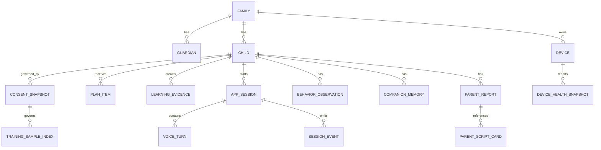

# 数据库与事件 PRD

日期：2026-06-16
版本：v0.1 研发准备版

## 1. 设计原则

- 儿童数据以家庭和监护授权为中心。
- 原始高敏音视频默认不进入云端数据库。
- 行为、学习、AI 输出和训练样本必须带 `consent_snapshot_id`。
- 事件用于产品验证和安全审计，不用于连续监控孩子。
- 删除、撤回授权、匿名化必须可追踪。

## 2. 数据域

| 域 | 表前缀 | 说明 |
|---|---|---|
| 身份与家庭 | identity | 家庭、监护人、孩子 |
| 设备 | device | 平板、底座、吊坠 |
| 授权与合规 | consent | 同意快照、删除请求、审计 |
| 计划与学习 | learning | 计划、学习证据、知识点、复习 |
| 会话与行为 | session | App Session、行为观察、娱乐收尾 |
| 语音交互 | voice | 语音轮次、意图、工具调用摘要、隐私状态 |
| 陪伴与内容 | companion/content | 记忆、故事、内容白名单 |
| 家长教练 | parent | 脚本卡、反馈、报告 |
| 事件与指标 | event/metric | 原始事件、聚合指标 |
| AI 与策略 | ai/strategy | 模型版本、策略版本、反馈 |

## 3. 概念模型



## 4. 核心表

### DB-001 family

| 字段 | 类型 | 约束 | 说明 |
|---|---|---|---|
| family_id | uuid | pk | 家庭 ID |
| region_code | text | not null | 地区 |
| timezone | text | not null | 时区 |
| created_at | timestamptz | not null | 创建时间 |
| status | text | not null | active/suspended/deleted |

### DB-002 guardian_profile

| 字段 | 类型 | 约束 | 说明 |
|---|---|---|---|
| guardian_id | uuid | pk | 家长 ID |
| family_id | uuid | fk | 家庭 ID |
| role | text | not null | parent/grandparent/other_guardian |
| display_name | text | nullable | 昵称 |
| phone_hash | text | nullable | 手机哈希 |
| email_hash | text | nullable | 邮箱哈希 |
| auth_level | text | not null | owner/member/viewer |
| created_at | timestamptz | not null | 创建时间 |

### DB-003 child_profile

| 字段 | 类型 | 约束 | 说明 |
|---|---|---|---|
| child_id | uuid | pk | 孩子 ID |
| family_id | uuid | fk | 家庭 ID |
| nickname | text | not null | 昵称 |
| birth_year | integer | nullable | 出生年，避免保存完整生日 |
| grade | text | not null | 年级 |
| curriculum_region | text | not null | 课程地区 |
| learning_preferences | jsonb | not null default '{}' | 学习偏好 |
| accessibility_needs | jsonb | not null default '{}' | 辅助需求 |
| status | text | not null | active/deleted |

### DB-004 device_profile

| 字段 | 类型 | 约束 | 说明 |
|---|---|---|---|
| device_id | uuid | pk | 设备 ID |
| family_id | uuid | fk | 家庭 ID |
| child_id | uuid | nullable fk | 绑定孩子 |
| device_type | text | not null | tablet/dock/pendant |
| serial_hash | text | unique | 序列号哈希 |
| firmware_version | text | nullable | 固件版本 |
| app_version | text | nullable | App 版本 |
| policy_version | text | nullable | 策略版本 |
| last_seen_at | timestamptz | nullable | 最近在线 |
| status | text | not null | active/lost/retired/deleted |

### DB-005 consent_snapshot

| 字段 | 类型 | 约束 | 说明 |
|---|---|---|---|
| consent_snapshot_id | uuid | pk | 授权快照 |
| family_id | uuid | fk | 家庭 |
| child_id | uuid | fk | 孩子 |
| guardian_id | uuid | fk | 授权人 |
| scopes | jsonb | not null | learning_analysis, parent_report 等 |
| data_categories | jsonb | not null | 数据类别 |
| cloud_processing_allowed | boolean | not null | 云端处理 |
| training_allowed | boolean | not null | 训练用途 |
| retention_policy_id | uuid | nullable | 留存策略 |
| effective_at | timestamptz | not null | 生效 |
| revoked_at | timestamptz | nullable | 撤回 |
| version | integer | not null | 版本 |

### DB-006 app_session

| 字段 | 类型 | 约束 | 说明 |
|---|---|---|---|
| session_id | uuid | pk | 会话 ID |
| child_id | uuid | fk | 孩子 |
| family_id | uuid | fk | 家庭 |
| device_id | uuid | fk | 平板 |
| activity_type | text | not null | learning/story/game/video/rest/share |
| content_mode | text | not null | internal/webview/sdk/builtin_player/allowlisted_app/offline |
| content_ref | text | nullable | 内容引用 |
| status | text | not null | proposed/active/ending/completed/interrupted/violated |
| duration_budget_seconds | integer | not null | 预算 |
| actual_duration_seconds | integer | nullable | 实际 |
| result | text | nullable | completed/child_resisted/timeout/parent_override/external_unknown |
| child_response | text | nullable | calm/negotiated/upset/ignored/unknown |
| returned_to_launcher | boolean | nullable | 是否返回主屏 |
| policy_version | text | not null | 策略版本 |
| consent_snapshot_id | uuid | fk | 授权快照 |
| started_at | timestamptz | nullable | 开始 |
| ended_at | timestamptz | nullable | 结束 |
| created_at | timestamptz | not null | 创建 |

索引：

- `(child_id, started_at desc)`
- `(family_id, activity_type, started_at desc)`
- `(policy_version)`

### DB-007 learning_evidence

| 字段 | 类型 | 约束 | 说明 |
|---|---|---|---|
| learning_evidence_id | uuid | pk | 学习证据 |
| session_id | uuid | fk | 会话 |
| child_id | uuid | fk | 孩子 |
| subject | text | not null | 学科 |
| knowledge_points | jsonb | not null | 知识点 |
| problem_ref | text | nullable | 题目引用 |
| answer_summary | jsonb | not null default '{}' | 答案摘要 |
| correctness | text | not null | correct/incorrect/partial/unknown |
| mistake_tags | jsonb | not null default '[]' | 错因 |
| duration_seconds | integer | nullable | 用时 |
| hint_count | integer | not null default 0 | 提示次数 |
| independent_level | text | not null | independent/hinted/guided |
| next_review_at | timestamptz | nullable | 下次复习 |
| consent_snapshot_id | uuid | fk | 授权 |
| retention_until | timestamptz | not null | 留存到期 |
| deletion_status | text | not null | active/delete_requested/deleted/anonymized |
| created_at | timestamptz | not null | 创建 |

### DB-008 plan_item

| 字段 | 类型 | 约束 | 说明 |
|---|---|---|---|
| plan_item_id | uuid | pk | 计划项 |
| child_id | uuid | fk | 孩子 |
| plan_date | date | not null | 日期 |
| task_type | text | not null | homework/review/story/game/video/rest |
| subject | text | nullable | 学科 |
| title | text | not null | 标题 |
| knowledge_points | jsonb | not null default '[]' | 知识点 |
| expected_duration_seconds | integer | not null | 预计时长 |
| status | text | not null | planned/started/completed/skipped/adjusted |
| adjustment_reason | text | nullable | 调整原因 |
| source | text | not null | cloud/local/parent |
| policy_version | text | not null | 策略版本 |
| created_at | timestamptz | not null | 创建 |

### DB-009 parent_report

| 字段 | 类型 | 约束 | 说明 |
|---|---|---|---|
| report_id | uuid | pk | 报告 |
| child_id | uuid | fk | 孩子 |
| family_id | uuid | fk | 家庭 |
| report_type | text | not null | daily/weekly/monthly |
| period_start | date | not null | 开始 |
| period_end | date | not null | 结束 |
| factual_summary | text | not null | 事实摘要 |
| interpretation | text | not null | 谨慎解释 |
| recommendations | jsonb | not null | 建议 |
| parent_script_card_ids | uuid[] | not null default '{}' | 脚本 |
| risk_flags | jsonb | not null default '[]' | 风险 |
| model_version | text | not null | 模型 |
| policy_version | text | not null | 策略 |
| consent_snapshot_id | uuid | fk | 授权 |
| generated_at | timestamptz | not null | 生成 |
| deletion_status | text | not null | 删除状态 |

### DB-010 parent_script_card

| 字段 | 类型 | 约束 | 说明 |
|---|---|---|---|
| parent_script_card_id | uuid | pk | 脚本卡 |
| child_id | uuid | fk | 孩子 |
| scenario | text | not null | 场景 |
| child_context_summary | text | not null | 孩子状态摘要 |
| recommended_words | jsonb | not null | 一套话术 |
| concrete_actions | jsonb | not null | 今天做什么、多久 |
| avoid_examples | jsonb | not null | 避免事项和替代表达 |
| evidence_refs | uuid[] | not null default '{}' | 证据引用 |
| model_version | text | not null | 模型 |
| created_at | timestamptz | not null | 创建 |

### DB-011 audit_log

| 字段 | 类型 | 约束 | 说明 |
|---|---|---|---|
| audit_log_id | uuid | pk | 审计 ID |
| actor_type | text | not null | guardian/system/admin/device |
| actor_id | uuid | nullable | 操作者 |
| family_id | uuid | nullable | 家庭 |
| child_id | uuid | nullable | 孩子 |
| action | text | not null | 动作 |
| target_type | text | not null | 对象类型 |
| target_id | uuid | nullable | 对象 |
| before_summary | jsonb | nullable | 变更前摘要 |
| after_summary | jsonb | nullable | 变更后摘要 |
| consent_snapshot_id | uuid | nullable | 授权 |
| occurred_at | timestamptz | not null | 时间 |

### DB-012 guardian_rule

| 字段 | 类型 | 约束 | 说明 |
|---|---|---|---|
| guardian_rule_id | uuid | pk | 规则 ID |
| family_id | uuid | fk | 家庭 |
| child_id | uuid | fk | 孩子 |
| rule_type | text | not null | sleep/entertainment/content/privacy/learning |
| rule_body | jsonb | not null | 规则内容 |
| effective_from | timestamptz | not null | 生效开始 |
| effective_until | timestamptz | nullable | 生效结束 |
| policy_version | text | not null | 策略版本 |
| created_by_guardian_id | uuid | fk | 创建人 |
| status | text | not null | active/disabled/deleted |
| created_at | timestamptz | not null | 创建 |

### DB-013 content_allowlist

| 字段 | 类型 | 约束 | 说明 |
|---|---|---|---|
| content_allowlist_id | uuid | pk | 白名单 ID |
| family_id | uuid | nullable fk | 家庭级白名单，空表示全局 |
| child_id | uuid | nullable fk | 孩子级白名单 |
| content_type | text | not null | video/game/story/app/webview/sdk |
| content_ref | text | not null | 内容 ID、URL hash、包名或 SDK ID |
| title | text | not null | 展示标题 |
| age_band | text | nullable | 年龄段 |
| max_duration_seconds | integer | nullable | 单次最大时长 |
| provider | text | nullable | 内容提供方 |
| policy_version | text | not null | 策略版本 |
| status | text | not null | active/disabled/deleted |

### DB-014 sensor_event

| 字段 | 类型 | 约束 | 说明 |
|---|---|---|---|
| sensor_event_id | uuid | pk | 传感事件 |
| child_id | uuid | fk | 孩子 |
| device_id | uuid | fk | 来源设备 |
| source | text | not null | pendant/dock/tablet |
| event_type | text | not null | audio_scene/motion/wear/privacy/device |
| label | text | not null | 标签 |
| confidence | numeric | nullable | 置信度 |
| started_at | timestamptz | not null | 开始 |
| ended_at | timestamptz | nullable | 结束 |
| evidence_ref | text | nullable | 本地或对象引用 |
| local_only | boolean | not null default true | 是否仅本地 |
| consent_snapshot_id | uuid | fk | 授权 |
| retention_until | timestamptz | not null | 留存到期 |
| deletion_status | text | not null | active/delete_requested/deleted/anonymized |
| model_version | text | nullable | 模型版本 |
| created_at | timestamptz | not null | 创建 |

### DB-014A privacy_decision

`privacy_decision` 是 Privacy Gateway 的审计核心。任何摄像头、麦克风、吊坠片段、作业图像或高敏上传请求，都必须能追溯到一条隐私决策记录。

| 字段 | 类型 | 约束 | 说明 |
|---|---|---|---|
| privacy_decision_id | uuid | pk | 隐私决策 ID |
| family_id | uuid | fk | 家庭 |
| child_id | uuid | nullable fk | 孩子 |
| request_id | uuid | not null | 本次能力请求 |
| session_id | uuid | nullable fk | App Session |
| lease_id | uuid | nullable | 底座能力租约 |
| source | text | not null | tablet/dock/pendant/cloud |
| capability | text | not null | camera/audio/pendant_snippet/homework_image/gimbal |
| input_summary | jsonb | not null default '{}' | 输入摘要，不含原始媒体 |
| hardware_state | text | not null | open/covered/muted/unavailable |
| consent_snapshot_id | uuid | fk | 授权快照 |
| policy_version | text | not null | 规则版本 |
| sensitive_scene_result | text | not null | pass/reject/unknown/not_applicable |
| third_party_presence | text | not null | none/possible/unknown/not_applicable |
| action | text | not null | allow_local/allow_upload_summary/allow_upload_media/reject/delete |
| rejected_reason | text | nullable | 拒绝原因 |
| retention_until | timestamptz | nullable | 留存到期 |
| audit_log_id | uuid | nullable fk | 审计引用 |
| created_at | timestamptz | not null | 创建 |

约束：

- `action=allow_upload_media` 必须有明确授权，且不能由默认策略产生。
- `action=reject/delete` 不得保存原始媒体对象引用。
- 删除请求生效后，新隐私决策不得允许同范围高敏上传。

### DB-015 device_health_snapshot

| 字段 | 类型 | 约束 | 说明 |
|---|---|---|---|
| device_health_snapshot_id | uuid | pk | 健康快照 |
| device_id | uuid | fk | 设备 |
| battery_level | integer | nullable | 电量 |
| charging_state | text | nullable | charging/discharging/full/unknown |
| network_state | text | nullable | online/offline/weak |
| storage_state | jsonb | not null default '{}' | 存储 |
| firmware_version | text | nullable | 固件 |
| model_version | text | nullable | 端侧模型 |
| health_flags | jsonb | not null default '[]' | 异常 |
| observed_at | timestamptz | not null | 观察时间 |

### DB-015A child_state_event

`child_state_event` 是 Local Child State Engine 的低敏状态输出表，用于实时 Agent 反馈、会话聚合、计划调整和家长报告趋势。它不保存原始视频、原始音频、连续帧、人脸图像或完整语音转写。

| 字段 | 类型 | 约束 | 说明 |
|---|---|---|---|
| child_state_event_id | uuid | pk | 状态事件 ID |
| family_id | uuid | fk | 家庭 |
| child_id | uuid | fk | 孩子 |
| session_id | uuid | nullable fk | App Session |
| device_id | uuid | fk | 生成事件的底座 |
| privacy_decision_id | uuid | fk | 隐私决策 |
| state_type | text | not null | present/away_from_seat/attention_stable/attention_dropping/stuck_or_paused/tired_like/frustrated_like/high_arousal/unknown |
| confidence | numeric | not null | 0-1 |
| evidence_tags | jsonb | not null default '[]' | head_down_long/writing_paused/fidgeting_increase 等低敏证据标签 |
| duration_sec | integer | nullable | 状态持续时间 |
| local_action_hint | text | nullable | gentle_check_in/offer_hint/suggest_break/none |
| cloud_summary_allowed | boolean | not null default false | 是否允许上传摘要 |
| raw_media_uploaded | boolean | not null default false | 默认必须为 false |
| model_version | text | not null | LCSE 模型版本 |
| policy_version | text | not null | 状态融合/行动策略版本 |
| created_at | timestamptz | not null | 创建时间 |

约束：

- `raw_media_uploaded=true` 只能在单独授权的质量评估样本流程中出现，且必须有对应 `privacy_decision.action=allow_upload_media`。
- `state_type=unknown` 不得生成 `local_action_hint`，除非动作为 `none` 或温和澄清。
- `evidence_tags` 禁止保存原始文本、图片、音频片段、第三方身份或可识别人脸信息。

### DB-016 deletion_request

| 字段 | 类型 | 约束 | 说明 |
|---|---|---|---|
| deletion_request_id | uuid | pk | 删除请求 |
| family_id | uuid | fk | 家庭 |
| child_id | uuid | nullable fk | 孩子 |
| guardian_id | uuid | fk | 请求人 |
| data_scope | text | not null | all/reports/learning/media/companion/events |
| request_type | text | not null | delete/anonymize/export_then_delete |
| status | text | not null | requested/processing/completed/failed/cancelled |
| requested_at | timestamptz | not null | 请求时间 |
| completed_at | timestamptz | nullable | 完成时间 |
| failure_reason | text | nullable | 失败原因 |
| audit_log_id | uuid | nullable fk | 审计 |

### DB-017 model_registry

| 字段 | 类型 | 约束 | 说明 |
|---|---|---|---|
| model_registry_id | uuid | pk | 模型/策略注册 ID |
| model_type | text | not null | base/task/safety/prompt/policy/knowledge |
| model_name | text | not null | 名称 |
| version | text | not null | 版本 |
| status | text | not null | draft/evaluating/approved/active/retired/rolled_back |
| eval_result | jsonb | not null default '{}' | 评测结果 |
| rollout_scope | jsonb | not null default '{}' | 灰度范围 |
| rollback_target | text | nullable | 回滚目标版本 |
| owner | text | not null | 负责人 |
| created_at | timestamptz | not null | 创建 |

### DB-018 ai_request_log

| 字段 | 类型 | 约束 | 说明 |
|---|---|---|---|
| ai_request_id | uuid | pk | AI 请求 ID |
| family_id | uuid | fk | 家庭 |
| child_id | uuid | fk | 孩子 |
| session_id | uuid | nullable fk | 会话 |
| request_type | text | not null | tutoring_turn/daily_plan/parent_script 等 |
| risk_level | text | not null | R0/R1/R2/R3 |
| model_version | text | not null | 模型版本 |
| prompt_version | text | not null | 提示词版本 |
| policy_version | text | not null | 策略版本 |
| knowledge_version | text | nullable | 知识库版本 |
| consent_snapshot_id | uuid | fk | 授权 |
| input_manifest | jsonb | not null | 输入来源清单，不存敏感原文 |
| output_ref | text | nullable | 输出引用 |
| safety_status | text | not null | passed/blocked/degraded/escalated |
| latency_ms | integer | nullable | 延迟 |
| cost_units | numeric | nullable | 成本单位 |
| created_at | timestamptz | not null | 创建 |

### DB-019 knowledge_corpus

| 字段 | 类型 | 约束 | 说明 |
|---|---|---|---|
| corpus_id | uuid | pk | 语料 ID |
| subject | text | not null | 学科 |
| grade | text | not null | 年级 |
| curriculum_region | text | not null | 课程地区 |
| source_type | text | not null | curriculum/method/problem/explanation |
| source_ref | text | not null | 来源引用 |
| knowledge_points | jsonb | not null default '[]' | 知识点 |
| content_hash | text | not null | 内容哈希 |
| embedding_ref | text | nullable | 向量引用 |
| review_status | text | not null | draft/reviewed/approved/retired |
| version | text | not null | 版本 |
| created_at | timestamptz | not null | 创建 |

### DB-020 eval_run

| 字段 | 类型 | 约束 | 说明 |
|---|---|---|---|
| eval_run_id | uuid | pk | 评测 ID |
| eval_set | text | not null | 评测集 |
| model_version | text | not null | 模型 |
| prompt_version | text | not null | 提示词 |
| policy_version | text | not null | 策略 |
| knowledge_version | text | nullable | 知识库 |
| pass_rate | numeric | not null | 通过率 |
| p0_failures | integer | not null | P0 失败数 |
| report | jsonb | not null default '{}' | 详情 |
| created_at | timestamptz | not null | 创建 |

### DB-021 training_sample_index

| 字段 | 类型 | 约束 | 说明 |
|---|---|---|---|
| training_sample_id | uuid | pk | 样本 ID |
| child_id | uuid | fk | 孩子 |
| family_id | uuid | fk | 家庭 |
| sample_type | text | not null | tutoring_quality/mistake_classification/parent_script_feedback/safety_blocked_case/plan_outcome |
| source_table | text | not null | 来源表 |
| source_id | uuid | not null | 来源 ID |
| deidentified_ref | text | nullable | 脱敏引用 |
| consent_snapshot_id | uuid | fk | 授权 |
| retention_until | timestamptz | not null | 留存到期 |
| training_allowed_until | timestamptz | nullable | 训练授权到期 |
| used_in_model_versions | text[] | not null default '{}' | 已使用模型版本 |
| deletion_status | text | not null | active/delete_requested/deleted/anonymized |

### DB-022 voice_turn

| 字段 | 类型 | 约束 | 说明 |
|---|---|---|---|
| voice_turn_id | uuid | pk | 语音轮次 ID |
| child_id | uuid | fk | 孩子 |
| family_id | uuid | fk | 家庭 |
| device_id | uuid | fk | 平板或底座 |
| session_id | uuid | nullable fk | 关联 App Session，可为空 |
| input_mode | text | not null | wake_word/press_to_talk/touch_fallback/system_prompt |
| started_at | timestamptz | not null | 开始时间 |
| ended_at | timestamptz | nullable | 结束时间 |
| asr_mode | text | not null | local/cloud/hybrid/not_recorded |
| intent | text | nullable | 识别意图 |
| intent_confidence | numeric | nullable | 置信度 |
| slots_summary | jsonb | not null default '{}' | 槽位摘要，不存敏感原文 |
| transcript_ref | text | nullable | 可选短期转写引用，默认空 |
| child_utterance_summary | text | nullable | 低敏摘要 |
| agent_response_summary | text | nullable | 回复摘要 |
| tool_calls | jsonb | not null default '[]' | 工具调用摘要 |
| safety_status | text | not null | passed/blocked/degraded/escalated |
| privacy_state | text | not null | normal/privacy_pause/local_only |
| consent_snapshot_id | uuid | fk | 授权快照 |
| policy_version | text | not null | 策略版本 |
| model_version | text | nullable | 模型版本 |
| deletion_status | text | not null | active/delete_requested/deleted/anonymized |
| created_at | timestamptz | not null | 创建 |

索引：

- `(child_id, started_at desc)`
- `(session_id, started_at)`
- `(intent, started_at desc)`

约束：

- 默认不保存原始音频。
- `transcript_ref` 只允许指向短期、授权、可删除的转写对象。
- `slots_summary`、`child_utterance_summary` 不得包含孩子敏感倾诉完整原文。

## 5. 事件 Schema

基础字段：

```json
{
  "event_id": "uuid",
  "client_event_id": "string",
  "installation_id": "uuid",
  "family_id": "uuid",
  "child_id": "uuid",
  "guardian_id": "uuid|null",
  "session_id": "uuid|null",
  "event_name": "string",
  "occurred_at": "timestamp",
  "ingested_at": "timestamp",
  "app_version": "string",
  "firmware_version": "string|null",
  "schema_version": "string",
  "device_type": "tablet|dock|pendant|parent_app|cloud",
  "model_version": "string|null",
  "policy_version": "string|null",
  "experiment_ids": ["string"],
  "consent_snapshot_id": "uuid|null",
  "dedup_hash": "string",
  "properties": {}
}
```

properties 禁止包含：

- 原始音频。
- 原始视频。
- 人脸图像。
- 完整屏幕录制。
- 精确位置轨迹。
- 第三方账号标识。
- 未授权网页/通知正文。
- 孩子敏感倾诉完整原文。

## 6. 核心事件

| 事件 | 来源 | properties |
|---|---|---|
| launcher_viewed | 平板 | plan_item_count, dock_online, entertainment_budget_remaining |
| voice_wake_detected | 平板 | mode, device_id, local_only |
| voice_turn_started | 平板 | voice_turn_id, input_mode, privacy_state |
| voice_intent_detected | 平板/云端 | voice_turn_id, intent, confidence_bucket, slot_keys |
| voice_clarification_requested | 平板/云端 | voice_turn_id, candidate_intents |
| voice_tool_called | 平板/云端 | voice_turn_id, tool_name, result, latency_ms |
| voice_agent_response_played | 平板 | voice_turn_id, response_type, duration_ms |
| voice_turn_ended | 平板 | voice_turn_id, result, safety_status |
| barge_in_detected | 平板 | voice_turn_id, previous_state, new_intent |
| reminder_delivered | 平板/云端 | reminder_type, stage, source |
| reminder_snoozed | 平板 | reminder_type, snooze_seconds, reason_bucket |
| privacy_pause_requested | 平板/底座 | scope, source, duration_seconds |
| privacy_state_changed | 平板/底座/云端 | from_state, to_state, source, ack_status |
| privacy_decision_created | 底座/云端 | privacy_decision_id, capability, action, rejected_reason |
| lease_issued | 底座 | lease_id, capability, session_id, expires_in_seconds |
| lease_rejected | 底座 | capability, rejected_reason, policy_version |
| lease_revoked | 底座 | lease_id, reason |
| tablet_blocked_launch_attempt | 平板 | package_category, rule_id, time_bucket |
| app_session_proposed | 平板/底座 | activity_type, content_mode, duration_budget_seconds |
| app_session_started | 平板 | activity_type, content_mode |
| ending_warning_shown | 平板 | session_id, seconds_remaining |
| app_session_ended | 平板 | result, actual_duration_seconds, child_response, returned_to_launcher |
| learning_evidence_created | 平板/云端 | subject, knowledge_point_count, correctness, hint_count, independent_level |
| homework_capture_requested | 平板 | source=tablet_camera/dock_camera |
| homework_capture_completed | 底座/平板 | quality, cropped, rejected_reason |
| camera_privacy_rejected | 底座 | request_source, rejected_reason, privacy_decision_id |
| gimbal_mode_changed | 底座 | from_mode, to_mode, session_id |
| gimbal_safety_limited | 底座 | limit_type, axis, reason |
| child_state_event_created | 底座 | child_state_event_id, session_id, state_type, confidence_bucket, local_action_hint, raw_media_uploaded |
| child_state_unknown_reported | 底座 | session_id, reason_bucket, privacy_state |
| child_state_action_suggested | 底座/平板 | child_state_event_id, action_hint, accepted |
| pendant_sync_started | 底座 | pendant_device_id, battery_level, firmware_version |
| pendant_sync_completed | 底座 | event_count, health_flags, model_version |
| pendant_ota_completed | 底座/吊坠 | firmware_version, model_version, result |
| pendant_contact_fault_detected | 底座 | fault_type, retry_count |
| sensor_event_created | 底座/吊坠 | source, event_type, label, confidence_bucket |
| state_conflict_resolved | 平板/底座/云端 | state_type, winning_owner, conflict_reason |
| offline_policy_applied | 平板/底座 | capability, ttl_seconds, degraded_mode |
| companion_turn_completed | 平板/云端 | intent, safety_gate_result, response_mode |
| story_session_completed | 平板 | duration_seconds, ended_naturally |
| entertainment_session_ended | 平板 | content_mode, result, returned_to_launcher |
| parent_rule_updated | 家长端 | rule_type, policy_version, effective_from |
| audit_log_created | 云端 | actor_type, action, target_type |
| parent_report_viewed | 家长端 | report_type, age_hours |
| parent_script_feedback_submitted | 家长端 | scenario, executed, effectiveness_rating, parent_stress_rating |
| consent_updated | 家长端/云端 | scope_count, cloud_processing_allowed, training_allowed |
| deletion_requested | 家长端 | data_scope, request_type |
| ai_request_started | 云端 | request_type, risk_level, policy_version |
| ai_request_completed | 云端 | request_type, safety_status, latency_ms, cost_units |
| safety_evaluation_completed | 云端 | status, risk_tags, required_action |
| model_version_rolled_out | 云端 | model_type, version, rollout_scope |
| eval_run_completed | 云端 | eval_set, pass_rate, p0_failures |

## 7. 数据删除与留存

| 数据 | v0.1 默认留存 | 删除方式 |
|---|---|---|
| app_session | 180 天 | 删除或匿名化 |
| learning_evidence | 1 年 | 删除或匿名化 |
| parent_report | 1 年 | 删除 |
| parent_script_card | 180 天 | 删除 |
| raw homework image | 本地 7 天，云端授权后 30 天 | 删除对象存储引用 |
| raw audio/video sensitive snippet | 默认本地短期 | 到期删除 |
| voice_turn | 180 天 | 删除或匿名化 |
| voice transcript_ref | 默认不保存；授权后 7-30 天 | 删除对象存储引用 |
| audit_log | 3 年或合规要求 | 不直接删除，按法务策略处理 |
| training_sample_index | 授权期间 | 撤回后删除或去标识 |

说明：具体留存期限需按目标市场法务确认，v0.1 先实现可配置策略和删除状态机。

## 8. 物理设计建议

数据库：PostgreSQL。

事件：先进入事件表或事件队列，再异步聚合。

分区建议：

- `event_log` 按月分区。
- `app_session` 按 `started_at` 月分区或按 family hash 分片预留。
- `learning_evidence` 按 child_id + created_at 建索引。

幂等：

- 所有客户端事件必须带 `client_event_id`。
- 服务端以 `(installation_id, client_event_id)` 去重。

安全：

- 家庭级 row-level access 在服务层强制。
- 管理后台所有读取儿童数据的操作写入 `audit_log`。
- 训练样本只引用脱敏索引，不直接复制原始敏感内容。
