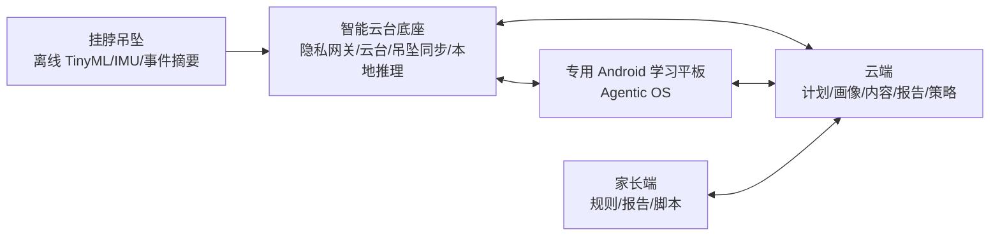

# 总体设计 PRD：儿童家教陪伴 Agentic OS

日期：2026-06-16
版本：v0.1 研发准备版
状态：Draft for development planning

## 1. 产品一句话

一套由专用 Android 学习平板、Jarvis-like 全局伴随式智能体、智能云台底座、挂脖吊坠、家长端和云端模型组成的儿童学习陪伴系统，通过自然语言主交互、全局上下文、跨端资源调度、受控 Agentic OS、行为微干预、科学学习计划和家长沟通建议，帮助孩子提升学习与自我管理能力。

说明：Jarvis-like 表示“全局智能管家式能力”，不是复制任何具体 IP 的名称、声音、形象、台词或人设。

## 2. 目标用户

| 用户 | 说明 | 核心诉求 |
|---|---|---|
| 孩子 | 小学至初中学生，v0.1 优先小学 3-6 年级 | 有人陪学、讲得懂、不被骂、娱乐有边界 |
| 家长 | 关注学习成绩和习惯养成的家庭 | 看见事实、知道怎么帮、减少冲突 |
| 研发/运营团队 | 内部团队 | 可验证、可迭代、可合规 |

v0.1 默认目标：

- 年龄：8-12 岁。
- 场景：家庭作业、复习、故事/小游戏/视频休息、家长日报。
- 学科：语文、数学、英语优先；科学类作为内容结构预留。
- 地区：先支持单一地区课程版本，字段保留多地区扩展。

## 3. 核心问题

| 问题 | 现状 | 产品解法 |
|---|---|---|
| 孩子不愿意持续学习 | 家长催促、孩子抵触 | Agent 陪伴 + 小步任务 + 非说教式启动 |
| 孩子容易被 Pad 娱乐带走 | 普通 Pad 入口太多 | 专用 Android 学习平板 + Launcher + Lock Task + 白名单 |
| 家长不知道孩子真正卡在哪 | 只看到成绩和作业结果 | 学习证据、错因、提示次数、复习计划 |
| 家长沟通容易升级为冲突 | 追问、比较、羞辱、威胁 | 个性化家长脚本和具体行动建议 |
| 行为数据敏感 | 音视频涉及儿童和家庭隐私 | 本地优先、摘要上传、授权、删除、审计 |

## 4. 产品形态

## 5. v0.1 范围

### 5.1 MUST

| 编号 | 能力 | 说明 |
|---|---|---|
| OVR-001 | 专用 Android 学习平板主屏 | Agentic Launcher 替代普通桌面 |
| OVR-002 | 全局伴随式智能体主交互 | 理解孩子意图、上下文和场景，提醒、陪伴、调度学习/底座/吊坠/云端/家长端/娱乐资源 |
| OVR-003 | 系统级儿童边界 | Device Owner、Lock Task、应用白名单、设置锁定基础验证 |
| OVR-004 | App Session | 学习、故事、游戏、视频、休息统一会话状态机 |
| OVR-005 | 学习会话 | 拍题/输入题目、讲题、提示、错因、复习计划 |
| OVR-006 | 陪伴会话 | Agent 聊天、讲故事、自然收尾、依恋边界 |
| OVR-007 | 娱乐边界 | 白名单视频/小游戏、倒计时、结束仪式、回到主屏 |
| OVR-008 | 底座协同 | 读取底座状态、云台拍题请求、吊坠同步状态 |
| OVR-009 | 家长端基础 | 规则、报告、白名单、隐私暂停、删除请求 |
| OVR-010 | 云端基础 | 计划生成、报告生成、内容白名单、策略下发 |
| OVR-011 | 数据与审计 | 核心表、核心事件、同意快照、删除状态、策略版本 |

### 5.2 SHOULD

| 编号 | 能力 | 说明 |
|---|---|---|
| OVR-012 | 全局上下文 | 低敏整合计划、会话、学习画像、设备状态、隐私状态和家长规则 |
| OVR-013 | 家长沟通脚本 | 根据孩子状态生成当天可执行话术和行动 |
| OVR-014 | 吊坠事件摘要 | 工程样机或模拟数据进入底座和孩子分享引导 |
| OVR-015 | 离线模式 | 最近计划、本地故事、基础练习可断网使用 |
| OVR-016 | 运营后台最小版 | 查看设备、事件、模型版本、报告生成状态 |

### 5.3 不做

- 不开放普通 Android 桌面和应用商店。
- 不支持孩子自由安装第三方 App。
- 不上传连续原始家庭视频。
- 不做学校实时监听。
- 不对孩子做心理/医学诊断。
- 不做老师端。
- 不复制具体影视 IP、声音、形象、名称、台词或人格设定。

## 6. 成功指标

| 指标 | v0.1 目标 | 说明 |
|---|---|---|
| 首次完成率 | >= 80% | 家长和孩子完成首次配置与首个活动 |
| 学习启动延迟 | 中位数 <= 5 分钟 | 从计划提醒到开始学习 |
| 学习会话完成率 | >= 70% | 学习会话正常完成或有效收尾 |
| 娱乐回主屏率 | >= 90% | 视频/游戏结束后回到 Agentic Launcher |
| 白名单拦截成功率 | >= 99% | 非授权 App 不能启动 |
| 家长日报阅读率 | >= 60% | 家长当天打开日报 |
| 家长脚本执行反馈率 | >= 25% | 家长对建议有反馈 |
| P0 隐私事故 | 0 | 原始敏感数据不得越权上传 |

## 7. 关键用户流程

### 7.1 首次激活

1. 家长开机进入激活流程。
2. 绑定家庭账号、孩子资料、地区课程版本。
3. 配对底座和吊坠。
4. 配置 Device Owner、Launcher、Lock Task、白名单。
5. 家长设置隐私、娱乐、睡眠、学习目标。
6. 孩子认识全局伴随式智能体、唤醒/打断方式、设备状态和隐私暂停入口。
7. 完成一个 5-10 分钟学习或故事体验。

验收：

- 激活流程可在 20 分钟内完成。
- 失败时明确告诉家长下一步。
- 孩子流程不展示成人化授权文案。

### 7.2 每日学习

1. 平板显示今日节奏，全局伴随式智能体根据计划、设备状态和孩子状态主动给出当天第一步。
2. 孩子通过语音或触控进入学习会话。
3. 系统获取题目：手动输入、平板拍照或底座云台拍题。
4. Agent 先提示方法，再逐步讲解。
5. 记录学习证据：知识点、错因、提示次数、用时、独立程度。
6. 生成下一次复习安排。
7. 家长日报展示事实和建议。

验收：

- 不确定答案时必须降级为方法提示或请求补拍。
- 不直接羞辱、比较、威胁。
- 学习证据可追溯到会话和同意快照。

### 7.3 娱乐收尾

1. 孩子从 Agentic Launcher 进入白名单视频/小游戏。
2. 系统创建 App Session 并进入 Lock Task 或内部容器。
3. 到点前 5 分钟提醒。
4. 到点执行结束仪式。
5. 保存进度并回到 Agentic Launcher。
6. 记录 child_response 和 returned_to_launcher。

验收：

- 不自动下一集。
- 不开放推荐流。
- 未回到主屏时记录异常并提示家长。

### 7.4 家长日报

1. 云端聚合学习证据、会话摘要、行为趋势和家长规则执行情况。
2. 生成日报：事实、解释、建议、可执行话术、避免事项。
3. 家长查看并反馈是否执行、是否有效、压力评分。

验收：

- 报告不展示完整敏感原文。
- 建议可直接执行，包含一句话以上话术、具体行动、避免事项。
- 不评价家长人格。

## 8. 系统边界

| 边界 | 要求 |
|---|---|
| 儿童安全 | 内容、依恋、沉迷、危机表达均需安全门 |
| 数据隐私 | 原始高敏数据默认本地，不进入事件 properties |
| 全局伴随边界 | 智能体可以像管家/教练一样主动协助，但不能成为排他性朋友或替代家长 |
| 系统控制 | 普通桌面、应用商店、开放浏览器、开发者模式不可给孩子使用 |
| 家长授权 | 云端处理、训练用途、敏感片段上传需有同意快照 |
| 可解释 | 计划、报告、干预均需 reason_summary |
| 可回滚 | 模型、策略、内容、系统 OTA 必须支持灰度和回滚 |

## 9. 研发里程碑

| 里程碑 | 输出 | 验收 |
|---|---|---|
| M0 范围重切 | v0.1a/v0.1b/v0.1c 范围、权威状态源、隐私状态机、儿童安全 Runbook | P0 范围明确，底座/吊坠不再阻塞 v0.1a |
| M1 v0.1a 平板系统原型 | Launcher、全局伴随智能体 Shell、DPC、Lock Task、白名单、App Session Enforcement | 非授权 App 被拦截，所有内容入口带 session，活动到点回主屏 |
| M2 v0.1a 学习/娱乐闭环 | 语音发起学习、学习会话、证据、复习计划、故事/小游戏/视频收尾 | 能完成 10 个核心家庭脚本，娱乐到点返回成功率 >= 90% |
| M3 v0.1a 家长与云端闭环 | 规则、授权撤回、隐私暂停、报告、脚本、删除 | 家长能配置、查看、反馈、删除；P0 安全用例 100% 通过 |
| M4 v0.1b 底座薄片 | 底座模拟器或工程样机、本地 API、能力租约、拍题、隐私状态、Local Child State Engine | 隐私暂停时拒绝拍题，无租约不能调用摄像头/云台，原始实时音视频不上云但可生成低敏状态摘要 |
| M5 v0.1c 吊坠薄片 | 吊坠事件模拟器或工程样机、入仓同步、低敏摘要、分享引导 | 低敏事件摘要进入平板，不作为审问证据 |
| M6 小规模试点 | 20-50 个家庭试点 SOP、设备健康、人工复核、成本跟踪 | 无 P0 隐私/安全事故，试点退出指标达标 |
