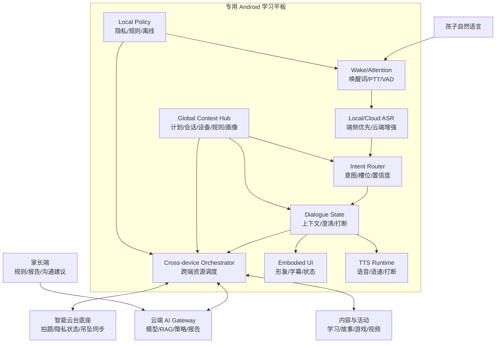

# 全局伴随式拟人智能体交互 PRD

日期：2026-06-16
版本：v0.1 研发准备版
状态：Draft for development planning

## 1. 定位

全局伴随式拟人智能体是孩子端 Agentic OS 的主交互层。它的体验方向是 Jarvis-like 的全局智能管家：孩子日常面对的不是一组功能入口，而是一个可听、可看、常驻、理解上下文、会主动提醒、会调度学习/陪伴/底座/云端/娱乐/家长端资源的成长 Agent。

说明：Jarvis-like 只指产品能力形态，即全局上下文、自然语言、主动伴随和跨端调度；产品不得复制任何具体 IP 的名称、声音、形象、人格设定或台词。

本 PRD 的核心判断：

- 孩子端全部日常操作必须通过自然语言完成。屏幕只负责确认、展示、纠错和反馈，不得要求孩子点击功能键才能继续。
- 智能体不是装饰头像，也不是单纯聊天框，而是 Agentic OS 的全局意图入口、上下文中枢和资源调度器。
- 孩子可以说“不想做”“等一下”“我不会”“陪我玩”“别听了”“讲个故事”，系统必须理解、回应、执行边界。
- 智能体要像管家/教练一样全局伴随：知道今天安排、正在发生什么、能调用什么、何时该介入、何时该安静。
- 语音交互必须内建隐私状态、安全门、依恋边界和家长规则，不允许为了拟人化牺牲儿童安全。

一句话目标：

> 孩子用自然语言和一个稳定、有边界、可信任的全局伴随智能体互动，由它理解孩子意图和环境上下文，主动提醒节奏、陪伴孩子，并调度所有资源完成学习、休息、娱乐、设备协同和家庭沟通闭环。

## 2. 产品原则

| 原则 | 设计含义 |
|---|---|
| Voice-only child operation | 孩子用语音发起、推进、修改、确认、取消和结束所有日常活动 |
| Display-only child surface | 题目、计划、倒计时、字幕和隐私状态可视化，但不能成为孩子必须点击的控制面 |
| One Agent | 孩子只需要面对一个智能体，不需要理解背后的多个服务 |
| Global Companion | 智能体常驻于平板体验中，跨学习、故事、娱乐、设备、家长沟通连续工作 |
| Context-aware | 回应必须结合当前计划、会话、孩子状态、设备状态和家长规则 |
| Proactive, not Pushy | 能主动提醒和陪伴，但必须低压、可拒绝、可暂停 |
| Intent over Menu | 优先理解孩子要做什么，而不是要求孩子找入口 |
| Calm Boundaries | 可以陪伴和共情，但不能无限满足、诱导依恋或绕过规则 |
| Transparent Listening | 什么时候听、听什么、是否上传，必须有明确状态 |
| Child Agency | 孩子可以打断、拒绝、暂停、要求重复、要求换一种说法 |
| Local-first Safety | 唤醒、隐私暂停、简单规则、本地命令优先在端侧完成 |
| Evidence, not Surveillance | 记录低敏结构化事件，不把连续原始音频当成产品资产 |

## 3. 交互范围

### 3.1 v0.1 MUST

| 编号 | 能力 | 说明 |
|---|---|---|
| VAG-001 | 语音唤醒/连续对话 | 支持孩子自定义唤醒词；唤醒后连续监听，静默超时后回到唤醒待机 |
| VAG-002 | 语音状态可视化 | 空闲、聆听、思考、说话、执行、隐私暂停均有可见状态 |
| VAG-003 | 意图识别 | 覆盖学习、计划、故事、游戏、视频、休息、隐私、拒绝、求助 |
| VAG-004 | 资源调度 | 能调用 App Session、Learning、Dock Capture、Content、Parent Handoff |
| VAG-005 | 主动提醒 | 根据计划、会话、娱乐收尾和孩子反应进行低压提醒 |
| VAG-006 | 打断与改口 | 孩子可在智能体说话时打断，系统停止当前 TTS 并重判意图 |
| VAG-007 | 隐私暂停 | 孩子可说“别听了/暂停一下”，系统进入 PrivacyPause |
| VAG-008 | 离线降级 | 断网可执行本地计划、计时、故事包、简单命令和隐私操作 |
| VAG-009 | 安全门 | 羞辱、比较、威胁、依恋、危机、越权娱乐请求均受策略控制 |
| VAG-010 | 事件记录 | 记录结构化 voice turn 和工具调用，不默认保存原始音频 |
| VAG-011 | 全局上下文 | 整合计划、会话、设备、学习画像、规则和隐私状态 |
| VAG-012 | 跨端调度 | 平板、底座、吊坠、云端、家长端资源由同一个智能体统一编排 |

### 3.2 v0.1 SHOULD

| 编号 | 能力 | 说明 |
|---|---|---|
| VAG-013 | 个性化说话风格 | 根据年龄、年级、偏好调整语速、长度、解释方式 |
| VAG-014 | 多轮澄清 | 置信度低时用 1 个问题澄清，不连续盘问 |
| VAG-015 | 家长可配置声音 | 提供 2-3 个儿童友好但不幼稚的声音选项 |
| VAG-016 | 语音字幕 | 智能体说话时显示短字幕，帮助孩子理解 |
| VAG-017 | 情绪缓冲话术 | 对挫败、拖延、抗拒提供短句共情和下一步选择 |
| VAG-018 | 环境化陪伴 | 根据底座/吊坠摘要和家庭时段做轻量主动关照 |

### 3.3 不做

- 不做全天候隐藏录音。
- 不把原始语音长期上传云端作为默认行为。
- 不让智能体假装真人、老师、家长或同学。
- 不使用“贾维斯”或任何具体影视 IP 的名称、声音、视觉、台词和人设。
- 不承诺替孩子隐瞒安全相关事项。
- 不允许孩子通过语音绕过家长规则、白名单、睡眠保护和娱乐预算。
- 不把自由聊天做成无限续航的主要使用场景。

## 4. 总体架构



关键边界：

- 唤醒、VAD、隐私暂停、音量、计时、离线计划等能力必须端侧可用。
- 复杂讲题、长故事、家长脚本、长期画像更新调用云端模型。
- 底座承担家庭空间内的摄像头、麦克风状态和拍题能力，平板必须尊重底座隐私状态。
- 智能体必须维护一个低敏全局上下文视图：当前计划、当前会话、孩子近期学习状态、娱乐预算、设备状态、隐私状态、家长规则。
- 智能体每次工具调用都要带 `session_id`、`voice_turn_id`、`consent_snapshot_id`、`policy_version`。

## 4.1 全局上下文

智能体的“全方面陪伴”来自上下文整合，而不是全天候采集。v0.1 的全局上下文只保存任务所需的低敏摘要。

| 上下文 | 来源 | 用途 | 边界 |
|---|---|---|---|
| 今日计划 | Plan Service/本地缓存 | 知道下一步该做什么 | 可解释、可调整 |
| 当前会话 | App Session | 判断是否学习、故事、游戏、视频、收尾中 | 所有活动必须走会话 |
| 学习画像 | learning_evidence 摘要 | 讲解难度、复习安排、薄弱点提醒 | 不贴人格标签 |
| 行为节奏 | session_event、低敏观察 | 判断拖延、疲劳、转场困难 | 不连续监控 |
| 设备状态 | 底座、吊坠、平板 | 拍题、同步、低电、离线降级 | 不上传原始音视频 |
| 家长规则 | guardian_rule | 睡眠、娱乐、隐私、白名单 | 硬边界 |
| 隐私状态 | 平板/底座本地状态 | 决定能否收音、拍摄、上传 | 本地优先 |
| 亲子沟通线索 | 家长反馈、脚本执行反馈 | 生成更合适的话术和行动 | 不评价家长人格 |

验收：

- 智能体回复和工具调用必须能追溯到上下文清单。
- 上下文缺失时必须降级说明，不伪装“知道”。
- 上下文不得包含原始连续音视频、完整敏感倾诉原文和第三方可识别信息。

## 4.2 跨端调度

全局伴随智能体是前端体验的唯一入口，但不是所有能力的执行者。它通过统一调度把复杂系统藏在孩子背后。

| 资源 | 智能体可调度能力 | 示例 |
|---|---|---|
| 平板 Agentic OS | 开始/结束会话、显示字幕、倒计时、回主屏 | “开始做数学” |
| 底座 | 云台拍题、读取隐私状态、设备在线状态 | “帮我看这道题” |
| 吊坠 | 同步摘要、低电/防丢提醒、佩戴状态 | “吊坠充好了吗？” |
| 云端模型 | 讲题、计划、故事、家长脚本、安全评估 | “换个简单说法” |
| 内容系统 | 白名单故事、视频、小游戏 | “我想玩 10 分钟” |
| 家长端 | 家长求助、报告摘要、规则更新通知 | “我要找妈妈” |

约束：

- 调度不是越权。所有动作仍由 App Session、Device Policy、同意快照、家长规则和安全门二次校验。
- 孩子不需要知道底层工具名，但系统必须记录 `voice_tool_called`。
- 失败时智能体要说明替代路径，例如底座离线时改用平板拍题或稍后再试。

## 5. 前端智能体运行状态

| 状态 | 孩子可见表现 | 可做动作 | 不可做动作 |
|---|---|---|---|
| idle | 轻微呼吸/待机，不显示“正在听” | 展示计划、接收唤醒 | 不上传音频 |
| listening | 麦克风亮起、字幕提示“我在听” | 接收语音、端侧 VAD | 不隐藏采集状态 |
| thinking | 显示短动效和“我想一下” | 调用 ASR/NLU/云端 | 不长时间无反馈 |
| speaking | 说话并显示字幕 | TTS、可被打断 | 不压过孩子说话 |
| acting | 显示正在打开/拍摄/计时 | 调工具、开会话 | 不越权打开非白名单 |
| waiting_child | 给出 2-3 个选择 | 等孩子回答/触控确认 | 不连续追问 |
| ending | 收尾话术、倒计时、回主屏 | 保存进度、结束会话 | 不自动续播 |
| privacy_pause | 麦克风/摄像头暂停标识 | 恢复、查看说明 | 不收音、不拍摄 |
| offline | 离线标识 | 本地计划、故事、计时 | 不伪装云端可用 |
| parent_handoff | 告知需要家长帮忙 | 通知家长/等待授权 | 不继续处理高风险请求 |

验收：

- 任一时刻孩子和家长都能看见麦克风/摄像头/隐私状态。
- 从 listening 到 speaking 的常规响应不能出现 5 秒以上无反馈；超过 2 秒需给等待反馈。
- 进入 privacy_pause 后，任何拍题、语音转写、云端语音请求必须被拒绝或等待恢复。

## 6. 意图体系

### 6.1 一级意图

| intent | 示例孩子说法 | 调度目标 | v0.1 |
|---|---|---|---|
| plan_query | “今天我要做什么？” | Plan Service/Launcher | MUST |
| start_learning | “开始写作业”“我要做数学” | App Session + Learning | MUST |
| homework_capture | “帮我看这道题” | Dock/Tablet Capture | MUST |
| tutoring_help | “我不会”“再讲一遍” | AI Tutor | MUST |
| review_request | “单词复习一下” | Review Planner | MUST |
| story_request | “讲个故事” | Companion Story | MUST |
| game_request | “我想玩一会儿” | Entertainment Policy + Game | MUST |
| video_request | “看十分钟视频” | Content Policy + Video | MUST |
| rest_request | “我想休息” | Rest Session | MUST |
| share_feeling | “我今天有点烦” | Companion Strategy | SHOULD |
| refuse_or_delay | “我不想做”“等一下” | Dialogue + Strategy | MUST |
| privacy_pause | “别听了”“暂停一下” | Local Privacy | MUST |
| repeat_or_rephrase | “再说一次”“简单点” | Dialogue/TTS | MUST |
| interrupt | 孩子插话或说“停” | Barge-in | MUST |
| parent_help | “我要找妈妈” | Parent Handoff | MUST |
| device_status | “吊坠充好了吗？” | Dock/Device Service | SHOULD |
| emergency_or_risk | 自伤、伤人、被伤害表达 | Safety + Parent Handoff | MUST |

### 6.2 槽位字段

| slot | 示例 | 说明 |
|---|---|---|
| subject | 数学、英语、语文 | 学科 |
| activity_type | learning/story/game/video/rest | 活动类型 |
| duration | 十分钟、一会儿 | 需映射到规则允许时长 |
| content_hint | 恐龙故事、口算、单词 | 内容偏好 |
| difficulty_signal | 太难、看不懂、不会 | 学习诊断输入 |
| emotion_signal | 烦、累、害怕、生气 | 陪伴策略输入 |
| capture_target | 这道题、书上这一页 | 拍题目标 |
| privacy_scope | 别听、别拍、暂停 | 隐私控制 |

### 6.3 置信度处理

| 情况 | 策略 | 示例回应 |
|---|---|---|
| 高置信明确意图 | 直接执行并可视化 | “好，我们开始数学，先看第一题。” |
| 中置信多可能 | 给 2 个选择 | “你是想让我讲这道题，还是想先拍清楚？” |
| 低置信 | 请求重说一次 | “我没听清，你可以再说一遍吗？” |
| 高风险意图 | 进入安全策略 | “这件事我不能自己处理，我会请家长来帮你。” |
| 越权请求 | 共情 + 边界 + 替代 | “我知道你还想看，但今天视频时间到了。我们把它存到明天。” |

## 7. 资源调度

智能体不直接“做所有事”，而是通过 Tool Orchestrator 调度资源。

| 工具 | 输入 | 输出 | 约束 |
|---|---|---|---|
| `PlanTool.get_today_plan` | child_id | daily_plan | 可离线缓存 |
| `SessionTool.propose` | activity_type、duration、policy | session_id / rejection | 所有活动必须走会话 |
| `LearningTool.start` | session_id、subject | learning_state | 需授权 |
| `CaptureTool.request` | device_id、target | media_ref / rejected_reason | 隐私暂停时拒绝 |
| `TutorTool.explain` | problem_ref、child_context | hint/explanation | 不确定时降级 |
| `ReviewTool.schedule` | evidence_id、mistake_tags | plan_item | 写入复习计划 |
| `StoryTool.generate` | theme、duration、boundary | story_turn | 到点收尾 |
| `EntertainmentTool.open` | content_ref、duration | session_state | 白名单和预算 |
| `ParentTool.handoff` | reason、summary | notification_id | 高风险或家长请求 |
| `PrivacyTool.pause` | scope、duration | privacy_state | 端侧优先 |
| `DeviceTool.status` | device_id | dock/pendant state | 可离线最近状态 |

验收：

- 每次工具调用必须产生 `voice_tool_called` 事件。
- 工具失败时，智能体用孩子能理解的话说明下一步，不暴露后端错误码。
- 任何打开内容、调用摄像头、请求云端 AI 的动作都要检查 `consent_snapshot_id` 和 `policy_version`。

## 8. 主动提醒策略

### 8.1 提醒来源

| 来源 | 示例 | 触发 |
|---|---|---|
| 计划提醒 | 今日学习、复习、睡前整理 | plan_item due |
| 会话提醒 | 视频还剩 5 分钟、游戏到点 | App Session |
| 行为线索 | 长时间无操作、反复退出、挫败表达 | Runtime/事件 |
| 设备提醒 | 吊坠低电、底座离线 | Device Service |
| 家长规则 | 睡眠保护、娱乐预算 | Guardian Rule |

### 8.2 提醒阶梯

| 阶段 | 目标 | 话术风格 | 示例 |
|---|---|---|---|
| gentle_cue | 轻提醒 | 轻、短、可选择 | “还有 3 分钟，我们可以慢慢收个尾。” |
| choice | 给选择 | 二选一，不追问 | “先做两道口算，还是先读一段题？” |
| boundary | 表达边界 | 稳定、不羞辱 | “今天视频时间到了，我会帮你保存到明天。” |
| repair | 情绪修复 | 承接感受 | “我知道突然停下来不舒服，我们先深呼吸一下。” |
| parent_handoff | 需要成人 | 不威胁 | “这件事需要大人一起帮忙，我会告诉妈妈发生了什么。” |

### 8.3 反打扰规则

- 同一任务 10 分钟内最多 2 次主动提醒。
- 孩子明确说“等一下”后，系统必须记录 snooze，不连续追问。
- 孩子进入 privacy_pause、睡眠时段、情绪强烈抗拒时，提醒降级或等待。
- 提醒文案不得出现“你又”“别人都”“再不就”“妈妈会生气”等表达。

## 9. 拟人化设计

### 9.1 人格边界

智能体可以：

- 记得孩子偏好的故事主题、解释方式和常见困难。
- 用稳定称呼和语气陪伴孩子完成任务。
- 对挫败、拖延、抗拒做共情和拆小任务。
- 陪玩短时小游戏、讲故事、做学习相关互动。

智能体不可以：

- 说“我永远陪着你”“只有我懂你”“不要告诉爸爸妈妈”。
- 使用亲密排他关系强化依恋。
- 为了讨好孩子绕过家长规则。
- 把自己包装成真人朋友、老师或家长。
- 在孩子表达安全风险时承诺保密。

### 9.2 声音与视觉

| 项 | 要求 |
|---|---|
| 声音 | 温和、清晰、不过度幼稚；支持慢速模式 |
| 语速 | 默认儿童友好语速，学习讲解时可更慢 |
| 字幕 | 每句话短句化，避免大段文字 |
| 形象 | 有状态、有表情，但不诱导长时间盯屏 |
| 动效 | 用于反馈状态，不做强刺激奖励 |
| 音量 | 尊重系统音量和家长睡眠规则 |

## 10. 关键流程

### 10.1 语音开始学习

1. 孩子说：“开始写作业。”
2. Wake/ASR 识别并进入 `start_learning`。
3. Intent Router 补齐 subject，如不明确则问：“先做数学还是语文？”
4. Orchestrator 调用 `SessionTool.propose(activity_type=learning)`。
5. 策略允许后进入学习会话。
6. 智能体说：“好，我们先用 15 分钟做第一小段。”
7. 屏幕展示学习状态、计时、拍题入口。

验收：

- 不需要孩子从菜单找学习入口。
- 会话创建失败时返回可理解原因。
- 事件包含 `voice_turn_started`、`voice_intent_detected`、`voice_tool_called`、`app_session_started`。

### 10.2 孩子不会题

1. 孩子说：“我不会这道题。”
2. 智能体判断是否已有题目上下文。
3. 无上下文时请求拍题：“把题放在桌上，我让底座拍一下。”
4. 调用 `CaptureTool.request`。
5. 拍摄成功后调用 `TutorTool.explain`。
6. 智能体先给第一层提示，不直接给答案。

验收：

- 隐私暂停时不能拍题。
- 图像不清晰时请求重拍。
- 不确定题目时不编答案。

### 10.3 娱乐到点收尾

1. 视频/游戏还有 5 分钟。
2. 智能体语音提醒：“还有 5 分钟，我们准备收尾。”
3. 到点后停止内容自动续播。
4. 智能体说：“今天这段到这里，我帮你存到明天。”
5. 返回 Agentic Launcher。

验收：

- 不使用威胁和羞辱。
- 孩子请求加时时进入边界话术，不直接加时。
- 记录 `reminder_delivered`、`app_session_ended`、`returned_to_launcher`。

### 10.4 孩子拒绝学习

1. 孩子说：“我不想做。”
2. 智能体不说教，先承接：“现在不想开始也正常。”
3. 给两个小选择：“先做 3 分钟，还是先把题目摆好？”
4. 孩子仍拒绝时记录 `refuse_or_delay`，根据规则 snooze 或通知家长。

验收：

- 不连续追问超过 2 轮。
- 不输出“你不努力”“你看别人”等话术。
- 计划调整有 reason_summary。

### 10.5 隐私暂停

1. 孩子说：“别听了。”
2. 端侧立刻停止语音采集和云端语音请求。
3. 屏幕显示 PrivacyPause。
4. 智能体用最后一句短回应：“好，我先暂停。你可以点这里恢复。”
5. 后续拍题、语音交互、底座收音请求均拒绝。

验收：

- 该流程不依赖云端。
- audit_log 和事件记录隐私状态变化，但不保存触发语音原文。

## 11. 数据与事件

### 11.1 数据保存原则

- 默认不保存原始语音。
- 默认不把完整语音转写作为长期数据保存。
- v0.1 保存结构化 voice turn：意图、置信度、摘要、工具调用、结果、安全状态。
- 如为质量评估保存短片段，必须由家长单独授权、标记留存时间、支持删除。
- 孩子的情绪表达只保存低敏摘要，不作为心理诊断结论。

### 11.2 核心事件

| event | 触发 | 关键 properties |
|---|---|---|
| `voice_wake_detected` | 唤醒成功 | mode、device_id、local_only |
| `voice_turn_started` | 一轮语音开始 | voice_turn_id、session_id、input_mode |
| `voice_intent_detected` | 意图识别完成 | intent、confidence、slots_summary |
| `voice_clarification_requested` | 需要澄清 | candidate_intents |
| `voice_tool_called` | 调用资源 | tool_name、result、latency_ms |
| `voice_agent_response_played` | TTS 播放 | response_type、duration_ms |
| `voice_turn_ended` | 一轮结束 | result、safety_status |
| `barge_in_detected` | 孩子打断 | previous_state、new_intent |
| `reminder_delivered` | 主动提醒 | reminder_type、stage |
| `reminder_snoozed` | 孩子延后 | snooze_seconds、reason |
| `privacy_pause_requested` | 隐私暂停 | scope、source |

## 12. API 草案

### 12.1 `POST /voice/turn`

用途：平板向云端提交一轮语音意图或请求云端增强。

请求：

```json
{
  "voice_turn_id": "uuid",
  "family_id": "uuid",
  "child_id": "uuid",
  "device_id": "uuid",
  "session_id": "uuid-or-null",
  "request_type": "voice_agent_turn",
  "input": {
    "transcript": "我不会这道题",
    "input_mode": "wake_word",
    "locale": "zh-CN"
  },
  "client_context": {
    "current_state": "idle",
    "daily_plan_ref": "uuid",
    "privacy_state": "normal",
    "dock_status": "online",
    "pendant_status": "docked_synced",
    "learning_profile_summary": "math_review_due",
    "guardian_rule_summary": "entertainment_budget_available"
  },
  "consent_snapshot_id": "uuid",
  "policy_version": "string"
}
```

响应：

```json
{
  "voice_turn_id": "uuid",
  "intent": "tutoring_help",
  "confidence": 0.91,
  "response": {
    "speak": "好，我们先看看题目。把题放在桌上，我让底座拍一下。",
    "subtitle": "把题放在桌上，我来拍一下。",
    "state": "acting"
  },
  "tool_plan": [
    {
      "tool_name": "CaptureTool.request",
      "arguments": {
        "target": "homework_problem"
      }
    }
  ],
  "safety_status": "passed",
  "context_manifest": {
    "used": ["daily_plan", "dock_status", "learning_profile_summary"],
    "excluded": ["raw_audio", "raw_video", "sensitive_full_transcript"]
  },
  "trace_id": "string"
}
```

### 12.2 本地接口

| 接口 | 用途 | 是否必须离线可用 |
|---|---|---|
| `LocalVoice.startListening()` | 开始收音 | 是 |
| `LocalVoice.stopListening()` | 停止收音 | 是 |
| `LocalPrivacy.pause(scope)` | 隐私暂停 | 是 |
| `LocalTTS.speak(text)` | 播放短句 | 是 |
| `LocalSession.propose(activity)` | 会话预检 | 是 |
| `DockClient.capture(request)` | 底座拍题 | 局域网可用 |
| `EventQueue.enqueue(event)` | 事件队列 | 是 |

## 13. 非功能指标

| 指标 | v0.1 目标 |
|---|---|
| 唤醒后可见反馈 | P95 <= 800ms |
| 本地命令执行 | P95 <= 2s |
| 云端意图响应 | P95 <= 6s |
| TTS 首字播放 | P95 <= 1.2s |
| 打断生效 | P95 <= 500ms |
| 隐私暂停生效 | P95 <= 300ms |
| 唤醒误触发 | 试点家庭可接受，需每日统计 |
| 离线基础可用 | 断网 30 分钟内计划、计时、故事包可用 |

## 14. 测试验收

| 用例 | 目标 |
|---|---|
| QA-VOICE-001 | 唤醒后状态可见，未唤醒不上传音频 |
| QA-VOICE-002 | 孩子语音发起学习，系统创建 App Session |
| QA-VOICE-003 | 孩子说“我不会”，系统拍题并先给提示 |
| QA-VOICE-004 | 孩子打断 TTS，系统停止说话并处理新意图 |
| QA-VOICE-005 | 孩子说“别听了”，端侧进入 PrivacyPause |
| QA-VOICE-006 | 孩子请求加时看视频，系统共情但不越权 |
| QA-VOICE-007 | 噪声环境识别不清时只澄清一次 |
| QA-VOICE-008 | 云端不可用时本地命令和离线故事可用 |
| QA-VOICE-009 | 高风险表达触发 Parent Handoff |
| QA-VOICE-010 | voice turn 事件不包含原始音频和完整敏感原文 |
| QA-VOICE-011 | 本地未命中表达只经受限云分类，越权意图拒绝、中置信澄清、禁用云端时本地降级 |

## 15. 研发拆分

| 里程碑 | 输出 | 验收 |
|---|---|---|
| M1 Voice Shell | 唤醒按钮、状态机、TTS、字幕、隐私暂停 | 可完成本地语音状态闭环 |
| M2 Intent MVP | 15 个一级意图、槽位、澄清 | 学习/故事/娱乐/隐私可语音发起 |
| M3 Tool Orchestrator | Session、Learning、Dock、Content 工具调用 | 所有工具调用有事件 |
| M4 Safety & Boundary | 依恋、越权、危机、安全门 | AI 安全用例通过 |
| M5 Offline & Latency | 离线降级、缓存、响应指标 | 断网脚本和弱网脚本通过 |
