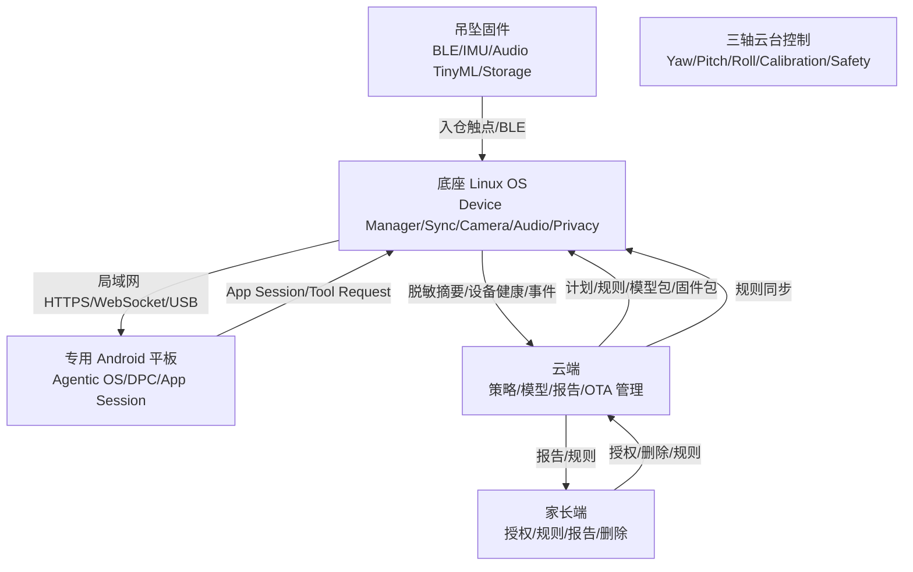

# 硬件相关软件与算法 PRD

日期：2026-06-17
版本：v0.1 研发准备版
关联文档：
- [硬件系统设计](../superpowers/specs/2026-06-16-hardware-system-design.md)
- [硬件零件可行性与 BOM 成本分析](../superpowers/specs/2026-06-16-hardware-feasibility-bom.md)
- [AI/算法设计](../superpowers/specs/2026-06-16-ai-algorithm-design.md)
- [孩子端 Agentic OS 设计](../superpowers/specs/2026-06-16-child-agentic-os-design.md)
- [数据库与事件 PRD](./2026-06-16-database-prd.md)

## 1. 结论

硬件相关的软件和算法目前不是“完全没有设计”，而是已经分散在硬件系统设计、AI/算法设计、Agentic OS 设计和数据库 PRD 中。缺口在于：还没有一份按硬件部件组织的研发规格，明确吊坠、底座、三轴云台、麦阵列、摄像头、专用平板之间的软件边界、算法输入输出、接口协议、状态机、OTA、诊断和验收标准。

本 PRD 补齐这层设计。它不是最终代码实现方案，但应足够指导 P0/P1 工程样机研发、供应商 RFQ 和测试用例拆分。

## 2. 总体架构



设计原则：

- 原始高敏音视频优先在底座本地处理，不默认上云。
- 实时视频和声音由底座 Local Child State Engine 本地解析为低敏状态事件，云端只接收摘要、趋势和置信度。
- 吊坠不联网，不做语义转写，不做摄像头采集。
- 底座是家庭边缘主机，负责硬件采集、隐私网关、设备同步和本地复核。
- 平板是孩子可见交互终端，负责 Agentic OS、动画、内容容器、App Session 和系统策略执行。
- 云端负责长期画像、学习诊断、计划、报告、模型治理和 OTA 编排。

## 3. 覆盖审计

| 能力 | 当前状态 | 需要补齐 |
|---|---|---|
| 吊坠 TinyML | 已有模型目标、功耗策略、事件类型 | 固件模块、事件 schema、入仓同步、模型更新、错误恢复 |
| 底座本地服务 | 已有服务清单 | 服务接口、状态机、日志、健康诊断、离线降级 |
| 三轴云台 | 已有硬件形态和成本拆分 | 控制协议、模式状态机、安全限位、校准、跟随算法验收 |
| 麦阵列/音频 | 已有远场音频和复核方向 | 唤醒、VAD、AEC、设备噪声过滤、隐私暂停链路 |
| 摄像头/视觉 | 已有作业拍摄、孩子观察、高拍仪方向 | Local Child State Engine、场景模式、目标跟随、作业裁剪、敏感过滤、画质指标 |
| 平板协同 | 已有 Dock Local API 初版 | API schema、租约、权限检查、失败码、重试 |
| OTA/模型更新 | 仅概念提到 | 固件包、模型包、灰度、回滚、版本依赖 |
| 设备事件 | 数据库已有部分事件 | 硬件健康、云台、音频、隐私、OTA 事件要补齐 |
| 测试验收 | 有端到端测试计划 | 需要硬件软件专项测试用例 |

## 4. 底座软件系统

### HSW-DCK-001 Device Manager

职责：

- 管理底座、平板、吊坠、云台、摄像头、麦克风、扬声器、状态灯、隐私按键、电源和触点。
- 维护设备状态机、能力表、固件版本、模型版本、电量、温度、网络、错误码。
- 为平板和云端提供统一设备状态。

状态：

| 状态 | 含义 |
|---|---|
| booting | 底座启动，自检未完成 |
| ready | 设备可用 |
| privacy_paused | 摄像头/麦克风暂停 |
| degraded | 某个硬件降级，例如云台遮挡、吊坠触点异常 |
| offline | 云端不可达，本地继续工作 |
| updating | 固件或模型更新中 |
| fault | 需要用户或售后介入 |

接口：

| API | 方向 | 说明 |
|---|---|---|
| `GET /dock/status` | 平板/家长端 -> 底座 | 获取设备状态、隐私状态、电量、云台、吊坠同步 |
| `GET /dock/capabilities` | 平板 -> 底座 | 获取当前硬件能力和降级能力 |
| `POST /dock/self-test` | 家长端/运维 -> 底座 | 启动自检，返回可读诊断 |
| `POST /dock/reboot` | 家长端/运维 -> 底座 | 受控重启，需要家长权限 |

验收：

- 底座启动后 15 秒内进入 ready 或 degraded。
- 任一硬件故障必须有稳定错误码和孩子/家长可理解的提示。
- 设备状态变化 1 秒内推送给平板。

### HSW-DCK-002 Local Event Store

职责：

- 保存本地短期事件、审阅队列、脱敏摘要、设备健康、同步队列。
- 原始音视频片段只允许短期加密缓存，并受留存策略自动删除。
- 支持断网补传摘要，不补传默认禁止上传的原始媒体。

数据类别：

| 数据 | 保存位置 | 默认留存 |
|---|---|---|
| 设备健康日志 | 底座本地 + 云端摘要 | 本地 30 天，云端 180 天 |
| 吊坠事件摘要 | 底座本地 + 云端摘要 | 本地 30 天，云端按家长授权 |
| 原始短片段 | 底座本地加密 | 24-72 小时，可配置更短 |
| 作业图像裁剪结果 | 底座/平板/云端 | 学习证据需要时保存 |
| 敏感过滤拒绝帧 | 不保存原图，只保存拒绝原因 | 事件级留存 |

验收：

- 断网 24 小时内不丢失低敏摘要。
- 删除请求下发后，本地原始片段必须在下一次联网或本地任务执行周期内删除。

### HSW-DCK-003 Privacy Gateway

职责：

- 管理摄像头、麦克风、吊坠短片段、作业图像进入云端前的过滤。
- 执行隐私暂停、物理遮挡、硬件静音、敏感场景过滤和上传许可检查。
- 给平板返回可解释的拒绝原因。

规则顺序：

1. 硬件物理状态：遮挡片、静音键、儿童暂停键。
2. 家长授权：摄像头、麦克风、作业图像、质量评估片段。
3. 当前场景：学习、娱乐、休息、夜间、家长模式。
4. 敏感过滤：旁人、人脸、卧室敏感、衣着敏感、私密区域。
5. 数据最小化：裁剪、打码、摘要化、拒绝上传。

验收：

- 物理遮挡或静音后，采集链路必须停止或返回空数据，不能只在 UI 上显示关闭。
- 隐私暂停 P95 生效时间 <= 300ms。
- 上传请求必须带 `consent_snapshot_id`、`policy_version`、`privacy_decision_id`。

### HSW-DCK-004 Local Child State Engine

职责：

- 在底座本地处理云台摄像头低帧率画面、远场音频特征、App Session、平板前台状态和家庭规则。
- 输出低敏 `child_state_event`，供平板 Agent 做实时陪伴，也供云端做长期趋势。
- 原始实时视频和声音默认不保存、不上传；需要质量评估样本时必须走单独授权和 `privacy_decision`。

状态输出：

| state_type | 用途 |
|---|---|
| `present` | 孩子在学习/陪伴区域内 |
| `away_from_seat` | 离席或离开镜头，不追向私密区域 |
| `attention_stable` | 专注相对稳定，不打扰 |
| `attention_dropping` | 专注下降线索，允许温和 check-in |
| `stuck_or_paused` | 停笔/停顿较久，允许提示或拍题引导 |
| `tired_like` | 疲劳线索，允许休息建议 |
| `frustrated_like` | 挫败线索，允许共情和降难度 |
| `high_arousal` | 高唤醒线索，必要时进入安全流程 |
| `unknown` | 置信度不足或隐私状态不允许，不触发建议 |

接口：

| API | 方向 | 说明 |
|---|---|---|
| `GET /child-state/current` | 平板 -> 底座 | 当前低敏状态、置信度、证据标签和本地行动建议 |
| `GET /child-state/session-summary` | 平板/云同步 -> 底座 | 当前 App Session 聚合状态摘要 |
| `POST /child-state/feedback` | 平板/家长端 -> 底座 | 孩子/家长对误报、打扰或帮助程度的反馈 |

验收：

- 本地状态事件 P95 延迟 <= 5 秒。
- 原始媒体默认上传率为 0。
- 每条状态事件必须包含 `privacy_decision_id`、`confidence`、`model_version`、`raw_media_uploaded=false`。
- 低置信度必须输出 `unknown`，不能生成行为建议或家长报告结论。

## 5. 三轴云台与视觉软件

### HSW-CAM-001 云台控制模式

| 模式 | 目标 | 云台行为 | 摄像头行为 |
|---|---|---|---|
| companion_observe | 默认陪伴观察 | 平视偏下，跟随孩子上半身 | 低帧率本地理解，不默认保存 |
| desk_scan | 高拍仪/拍题 | 前出下俯，覆盖 A4/A3 | 高分辨率拍摄、裁剪、清晰度判断 |
| activity_observe | 运动/体感游戏 | 扩大水平跟随，限制隐私区域 | 低延迟动作线索 |
| preview | 孩子/家长查看画面 | 用户可见预览 | 不自动上传 |
| privacy_pause | 暂停 | 回到安全位或遮挡 | 停止采集 |
| calibration | 校准 | 限位、回中、焦距/畸变标定 | 保存标定参数 |

验收：

- 模式切换有可见反馈，不能静默转动。
- companion_observe 到 desk_scan P95 切换时间 <= 2 秒。
- privacy_pause 时云台回到安全位或物理遮挡状态。

### HSW-CAM-002 云台安全限位

要求：

- Yaw 机械范围 +/-100 度，软件默认 +/-80 度。
- Pitch -95 到 +35 度，禁止持续扫向敏感区域。
- Roll 仅用于补偿，默认不参与大幅跟随。
- 支持堵转检测、儿童触碰检测、过流保护、过温保护和异常回中。
- 任一运动命令必须带 `request_source`、`session_id`、`reason`。

事件：

- `gimbal_mode_changed`
- `gimbal_motion_started`
- `gimbal_motion_completed`
- `gimbal_blocked`
- `gimbal_calibration_completed`
- `gimbal_safety_limited`

验收：

- 儿童手动阻挡云台时 200ms 内停止或降力。
- 云台异常后可回中，不能反复抖动。
- 所有云台运动事件可追溯到平板会话或底座本地策略。

### HSW-CAM-003 孩子观察与跟随子模块

目标：

- 它是 Local Child State Engine 的视觉子模块，不是独立监控系统。
- 在家庭学习和陪伴场景中，让智能体知道孩子是否在、是否看向屏幕/桌面、是否离席、是否出现明显疲劳或挫败线索。
- 不做身份识别数据库，不做医学诊断，不输出惩罚性评分。

输入：

- 云台摄像头低帧率画面。
- 当前 App Session。
- 隐私状态和家长规则。
- 平板前台状态。

输出：

| 输出 | 用途 |
|---|---|
| `child_presence` | 是否有人在学习位附近 |
| `attention_hint` | 看桌面/看屏幕/离席/不确定 |
| `posture_hint` | 长时间趴桌、频繁晃动、离开座位等低风险线索 |
| `affect_hint` | frustrated_like/tired_like/high_arousal/unknown，只做支持性线索 |
| `follow_target` | 云台跟随目标框，本地使用 |

验收：

- 输出必须有 `unknown`，不能强行判断。
- 低置信度不触发行为建议，只能触发温和澄清或忽略。
- 孩子离开桌面时不追到私密区域。
- 视觉子模块输出必须进入 LCSE 状态融合后才能触发 Agent 行动，不能单独决策。

### HSW-CAM-004 作业高拍算法

流程：

1. 平板或语音发起拍题请求。
2. Privacy Gateway 检查授权和隐私状态。
3. 云台切换 desk_scan。
4. 检测纸张/书本/屏幕边界。
5. 做畸变校正、透视矫正、清晰度检测、阴影检测。
6. 裁剪题区和答案区，减少背景。
7. 生成 `homework_capture_candidate`。
8. 平板显示结果，让孩子确认或重拍。

验收：

- A4 作业页常见桌面光照下，纸张检测成功率 >= 90%。
- 模糊、遮挡、反光时必须提示重拍，不能把低质量图送进讲题。
- 裁剪结果默认不包含孩子脸部和房间背景。

## 6. 音频软件与算法

### HSW-AUD-001 底座远场音频

模块：

- Wake/VAD：唤醒和语音活动检测。
- AEC：扬声器播放时回声消除。
- Noise Suppression：风扇、电机、环境噪声抑制。
- Beamforming：2-4 麦阵列方向增强。
- Audio Recheck：复核吊坠声学事件。

边界：

- 默认不长期保存原始语音。
- 默认不保存第三方声音转写。
- 云端只接收当前任务所需转写、摘要或结构化槽位。

验收：

- TTS 播放时仍能支持孩子打断，barge-in P95 <= 500ms。
- 云台运动噪声不应显著触发误唤醒。
- 隐私静音后底座和平板都显示同一状态。

### HSW-AUD-002 吊坠音频 TinyML

吊坠只做事件线索：

- VAD。
- quiet/noisy/classroom-like/outdoor/transition。
- shout/cry-like/high-arousal/conflict-like。
- turn_count。
- 摩擦/遮挡/摘下异常。

不做：

- 长语音转写。
- 语义理解。
- 学校监控。
- 情绪诊断。

验收：

- 重度策略续航目标 2-3 天。
- 误报可被底座复核消化，不能直接进入家长结论。
- 入仓同步成功率 >= 95%，失败可重试和 BLE 兜底同步核心事件。

## 7. 吊坠固件

### HSW-PND-001 固件模块

| 模块 | 职责 |
|---|---|
| Power Manager | 睡眠、唤醒、低电策略、电池健康 |
| Sensor Manager | 麦克风、IMU、触点、按键/LED/蜂鸣 |
| TinyML Runtime | 音频/运动事件推理 |
| Event Store | 本地加密环形队列 |
| Sync Agent | 入仓触点同步、BLE 兜底 |
| OTA Agent | 入仓后固件和模型更新 |
| Device Identity | 设备密钥、证书、反克隆 |

事件 schema：

```json
{
  "event_id": "uuid",
  "device_id": "pendant_id",
  "child_profile_id": "uuid",
  "started_at": "timestamp",
  "ended_at": "timestamp",
  "event_type": "audio_scene|motion|device_health",
  "label": "classroom_like|running|removed|low_battery",
  "confidence_bucket": "low|medium|high",
  "model_version": "string",
  "battery_level": 82,
  "snippet_ref": "optional_local_ref"
}
```

验收：

- 设备时间漂移可由底座校正。
- 低电时保留防丢、入仓同步和核心事件。
- 固件更新失败能回滚到上一稳定版本。

## 8. 底座和平板协同协议

### HSW-BRG-001 本地 API 与租约

平板调用底座能力必须通过租约机制：

| 字段 | 说明 |
|---|---|
| `lease_id` | 单次设备能力租约 |
| `session_id` | 当前 App Session |
| `capability` | camera_capture/audio_context/gimbal_move/pendant_sync |
| `expires_at` | 租约过期时间 |
| `policy_version` | 家长规则版本 |
| `consent_snapshot_id` | 授权快照 |
| `privacy_decision_id` | 隐私网关决策 |

典型 API：

| API | 方向 | 说明 |
|---|---|---|
| `POST /leases` | 平板 -> 底座 | 请求设备能力租约 |
| `POST /camera/capture-request` | 平板 -> 底座 | 发起拍题/预览 |
| `POST /gimbal/mode` | 平板 -> 底座 | 请求云台模式切换 |
| `GET /pendant/sync-summary` | 平板 -> 底座 | 获取吊坠同步摘要 |
| `POST /privacy/pause` | 平板/家长端 -> 底座 | 暂停采集 |
| `GET /events/local-summary` | 平板 -> 底座 | 获取低敏本地摘要 |

验收：

- 没有有效租约时，平板不能调用摄像头和云台。
- 断网时，底座仍能验证本地缓存规则。
- 底座拒绝能力调用时必须返回可解释失败码。

## 9. OTA 与模型治理

### HSW-OTA-001 更新对象

| 对象 | 更新来源 | 安装位置 | 回滚 |
|---|---|---|---|
| 吊坠固件 | 云端 -> 底座 -> 吊坠 | 入仓后触点更新 | A/B 或上一稳定包 |
| 吊坠 TinyML 模型 | 云端 -> 底座 -> 吊坠 | 入仓后更新 | 模型版本回滚 |
| 底座系统服务 | 云端 -> 底座 | 底座 Linux | 服务级回滚 |
| 底座模型包 | 云端 -> 底座 | 模型目录 | 版本 pin + 回滚 |
| 平板 Agentic OS | 云端/ODM OTA | Android 平板 | 灰度和回滚 |
| 规则包 | 云端 -> 平板/底座 | 本地缓存 | 版本回退 |

验收：

- 更新前检查电量、网络、存储、版本依赖。
- 更新失败不能导致吊坠不可同步或底座不可启动。
- 模型输出事件必须带 `model_version`。

## 10. 事件与监控补充

需要在数据库 PRD 基础上补充以下事件：

| 事件 | 产生端 | 核心字段 |
|---|---|---|
| `dock_status_changed` | 底座 | status, reason, firmware_version |
| `dock_self_test_completed` | 底座 | result, fault_codes |
| `gimbal_mode_changed` | 底座 | from_mode, to_mode, session_id |
| `gimbal_safety_limited` | 底座 | limit_type, axis, reason |
| `camera_privacy_rejected` | 底座 | request_source, rejected_reason |
| `homework_capture_quality_failed` | 底座/平板 | quality_reason, retry_count |
| `audio_privacy_muted` | 底座/平板 | source, duration_seconds |
| `pendant_ota_completed` | 底座/吊坠 | firmware_version, model_version, result |
| `pendant_contact_fault_detected` | 底座 | fault_type, retry_count |
| `model_package_activated` | 底座/吊坠/平板 | model_name, model_version, rollout_id |

监控指标：

- 底座在线率。
- 吊坠入仓识别成功率。
- 吊坠同步耗时 P50/P95。
- 云台模式切换耗时 P50/P95。
- 拍题成功率和重拍率。
- 隐私拒绝率。
- 音频误唤醒率。
- OTA 成功率和回滚率。

## 11. 硬件软件专项测试

| 测试编号 | 场景 | 验收 |
|---|---|---|
| HSW-QA-001 | 吊坠入仓同步 | 95% 以上一次识别成功，失败可重试 |
| HSW-QA-002 | 吊坠低电 | 自动降级，保留防丢和核心事件 |
| HSW-QA-003 | 吊坠 OTA 中断 | 不变砖，可回滚 |
| HSW-QA-004 | 底座断网 | 本地计划、隐私、设备状态仍可运行 |
| HSW-QA-005 | 隐私暂停 | 300ms 内停止采集并同步 UI |
| HSW-QA-006 | 云台堵转 | 200ms 内停止或降力，记录事件 |
| HSW-QA-007 | 云台拍题 | 常见桌面光照下 A4 纸张检测成功率 >= 90% |
| HSW-QA-008 | 云台跟随 | 不跟入私密区域，低置信度输出 unknown |
| HSW-QA-009 | 麦阵列 barge-in | TTS 播放时打断 P95 <= 500ms |
| HSW-QA-010 | 平板无租约调用摄像头 | 底座拒绝并返回原因 |
| HSW-QA-011 | 原始片段留存到期 | 自动删除，删除事件可审计 |
| HSW-QA-012 | 模型版本回滚 | 新模型异常时回到上一稳定版本 |

## 12. v0.1 研发优先级

P0 必须做：

- 底座 Device Manager。
- Privacy Gateway。
- Camera Service 的 desk_scan 模式。
- Gimbal Mode Controller 基础模式切换。
- Pendant Sync 和吊坠事件导入。
- 吊坠基础 TinyML 事件模拟或工程样机接入。
- 底座-平板本地 API 和租约机制。
- 设备健康、隐私、同步、拍题、OTA 基础事件。

P1 推荐做：

- companion_observe 孩子存在/离席/低风险姿态线索。
- activity_observe 运动观察。
- 麦阵列 AEC、barge-in 和电机噪声过滤优化。
- 吊坠 OTA 和模型包灰度。
- 云台安全限位完整测试。

P2 后续做：

- 更复杂的本地视觉复核。
- 底座本地轻量多模态模型。
- 多吊坠/多孩子家庭。
- UWB 防丢。
- 海外认证与多地区合规。

## 13. 尚未进入研发冻结的问题

| 问题 | 决策影响 | 建议 |
|---|---|---|
| 三轴云台采用现成模组还是 JDM 半定制 | 影响控制协议、成本、结构和交期 | P0 用现成模组，P1 并行 RFQ 半定制 |
| 吊坠单麦还是双麦 | 影响功耗、尺寸、事件准确率 | P0 单麦，P1 做 AB 样机 |
| 底座 SoC 选轻量网关档、6 TOPS LCSE 推荐档还是 12 TOPS 高端档 | 影响 LCSE 状态类别、帧率、模型并发、Linux BSP、散热和 BOM | P0 用 RK3576/RK3588 与 i.MX8MP 并行；DVT 前以 LCSE benchmark、热设计、BSP 稳定性和成本冻结 |
| 平板与底座是否使用 USB 常连 | 影响供电、延迟、结构和协议 | P0 局域网 + BLE，P1 验证 USB/触点 |
| 原始短片段默认留存时长 | 影响隐私和模型复核 | 默认 24-72 小时，家长可更短 |
