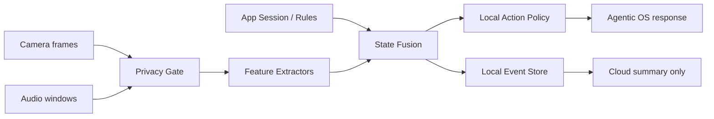

# Local Child State Engine PRD

日期：2026-06-17
版本：v0.1 研发准备版

## 1. 定位

Local Child State Engine 是运行在智能云台底座上的本地儿童状态引擎。它负责把实时摄像头、麦克风、云台、App Session、平板前台状态和家庭规则融合成低敏状态事件，让 Agent 能在本地及时陪伴、提醒和调度资源。

核心边界：

- 原始实时视频流和声音默认不上传云端。
- 本地可以短时处理音视频，但云端默认只接收结构化状态摘要、趋势、置信度和策略所需特征。
- 不做人脸身份识别库，不做心理/医学诊断，不承诺“读懂微表情”。
- 不输出惩罚性评分，不给孩子贴人格标签。
- 隐私暂停时必须停止相关采集链路、清空实时 buffer、冻结上传队列。

## 2. 能力目标

| 目标 | 说明 |
|---|---|
| 实时陪伴 | 2-5 秒内识别离席、卡住、疲劳、走神、明显挫败等低风险状态，供本地 Agent 温和回应 |
| 学习辅助 | 为讲题、复习、休息、拍题、娱乐收尾提供上下文，不依赖云端看到原始画面 |
| 长期趋势 | 给云端上传低敏状态事件和聚合趋势，支持计划调整和家长报告 |
| 隐私保护 | 原始音视频本地短时处理，默认不保存、不上传；高敏场景直接拒绝或只记录拒绝原因 |
| 可验证 | 状态输出必须包含置信度、证据类型、采集状态、模型版本和隐私决策引用 |

## 3. 输入与输出

### 3.1 输入

| 输入 | 来源 | 处理边界 |
|---|---|---|
| 低帧率视觉流 | 云台摄像头 | 默认 1-5 fps 状态理解；不进入云端 |
| 高帧率短窗 | 云台摄像头 | 仅运动/体感/跟随场景短时使用 |
| 远场音频特征 | 底座麦阵列 | VAD、音量、韵律、高唤醒线索；默认不保存原始音频 |
| App Session | 平板/底座 | 当前活动、时长、任务类型、剩余时间 |
| 平板前台状态 | 平板 | 是否在 Agentic OS、内容容器、学习会话或异常前台 |
| 云台状态 | 底座 | 观察模式、拍题模式、隐私暂停、堵转、跟随范围 |
| 家长规则 | 云端/底座 | 摄像头/麦克风授权、娱乐预算、睡眠保护、隐私偏好 |

### 3.2 输出

```json
{
  "child_state_event_id": "uuid",
  "family_id": "uuid",
  "child_id": "uuid",
  "session_id": "uuid|null",
  "source": "dock_local_child_state_engine",
  "state_type": "attention_dropping",
  "confidence": 0.74,
  "evidence_tags": ["head_down_long", "writing_paused", "fidgeting_increase"],
  "duration_sec": 180,
  "recommended_local_action": "gentle_check_in",
  "cloud_summary_allowed": true,
  "raw_media_uploaded": false,
  "privacy_decision_id": "uuid",
  "model_version": "lcse-vision-audio-0.1.0",
  "created_at": "timestamp"
}
```

## 4. 状态分类

| state_type | 说明 | 可触发动作 |
|---|---|---|
| present | 孩子在学习/陪伴区域内 | 保持当前活动 |
| away_from_seat | 离开学习位 | 等待、轻提醒、切换线下活动 |
| attention_stable | 专注相对稳定 | 不打扰 |
| attention_dropping | 专注下降线索持续出现 | 温和 check-in、拆小任务 |
| stuck_or_paused | 长时间停笔/停顿/反复看同一题 | 提供提示、建议拍题或换讲法 |
| tired_like | 疲劳线索 | 建议休息、降低任务强度 |
| frustrated_like | 挫败线索 | 共情、降难度、避免说教 |
| high_arousal | 高唤醒、喊叫、明显激动 | 降刺激、短句安抚；高风险转安全流程 |
| engaged_play | 运动/游戏参与中 | 继续活动或按时收尾 |
| unknown | 置信度不足或隐私状态不允许 | 不推断、不触发行为建议 |

状态命名必须使用 `*_like` 或 `*_hint` 表达不确定性，不能把线索当作确定心理事实。

## 5. 本地处理流水线



处理阶段：

1. Privacy Gate 检查隐私暂停、授权、敏感场景、设备租约。
2. Feature Extractors 只提取人体/姿态/手部/桌面/声学事件等低敏特征。
3. State Fusion 结合 App Session 和时间窗口，输出状态事件。
4. Local Action Policy 决定本地 Agent 是否回应，低置信度只忽略或澄清。
5. Cloud Sync 只上传低敏摘要和趋势，不上传原始音视频。

## 6. 本地模型分工

| 模型 | 运行位置 | 输出 | 边界 |
|---|---|---|---|
| Person/pose detector | 底座 NPU/CPU | presence、body_box、posture_hint | 不建立身份库 |
| Head/attention estimator | 底座 | look_tablet/look_desk/away/unknown | 粗粒度方向，不做精确视线追踪 |
| Hand/activity detector | 底座 | writing_like、idle_hand、book_interaction | 只判断任务参与线索 |
| Audio arousal/VAD | 底座 | speech_activity、shout_like、cry_like、silence_long | 不默认转写语义 |
| Desk/task detector | 底座 | book_present、paper_present、writing_paused | 辅助学习状态 |
| State fusion model | 底座 | child_state_event | 必须输出 unknown 和置信度 |

## 7. 云端消费方式

云端只能消费：

- `child_state_event` 单条低敏事件。
- 按 session 聚合的状态分布，例如 30 分钟学习中 `attention_stable=18min`、`stuck_or_paused=4min`。
- 趋势摘要，例如本周晚间学习疲劳线索增加。
- 模型质量指标，例如 unknown rate、误报反馈、缺失率。

云端不得默认消费：

- 原始视频。
- 原始音频。
- 连续帧序列。
- 可识别人脸图像。
- 第三方声音原文。
- 孩子敏感倾诉完整原文。

## 8. 本地 Agent 行动策略

| 状态 | 允许动作 | 禁止动作 |
|---|---|---|
| attention_dropping | “要不要先看第一步？”、“我们换个小目标” | “你又走神了” |
| stuck_or_paused | 给提示、邀请拍题、拆步骤 | 直接给答案、责备 |
| tired_like | 建议 3-5 分钟休息、眼保健操、喝水 | 继续催促完成全部任务 |
| frustrated_like | 共情、降低难度、提醒可以求助 | 评价能力、比较同学 |
| away_from_seat | 等待、轻提醒、切换运动任务 | 连续追问、把画面追到私密区域 |
| unknown | 不推断或轻问“我没看清，要继续吗？” | 用低置信度状态生成报告结论 |

## 9. 验收指标

| 指标 | v0.1b 工程样机目标 |
|---|---|
| 本地状态延迟 | P95 <= 5 秒 |
| 隐私暂停生效 | P95 <= 300ms，且停止采集链路 |
| unknown rate | 家庭学习典型场景 <= 35%，隐私/遮挡场景允许更高 |
| 原始媒体上传率 | 默认 0%，除非家长单独授权质量评估样本 |
| 误触发率 | 每 30 分钟学习会话 <= 2 次不合适主动提醒 |
| 状态事件完整性 | 100% 包含 `privacy_decision_id`、`model_version`、`confidence` |
| 降级体验 | 摄像头关闭时仍可基于 App Session、触控和语音做基本陪伴 |

## 10. 推荐硬件基线

LCSE 使底座从“隐私网关 + 拍题设备”升级为“本地多模态状态理解设备”，因此硬件基线要高于普通网关。

| 档位 | SoC/NPU | 内存/存储 | LCSE 能力边界 |
|---|---|---|---|
| 轻量验证档 | 2-3 TOPS 级 NPU | 4GB RAM / 32-64GB | 低帧率 presence、away、unknown、简单 VAD 和作业预处理 |
| v1.0 最低正式档 | 6 TOPS 级 NPU | 6GB RAM / 64GB | 人体/姿态/手部/音频/会话融合，状态类别可用但并发余量有限 |
| v1.0 推荐档 | 6 TOPS 级 NPU | 8GB RAM / 64-128GB | LCSE 多模型并发、A/B 模型灰度、审阅队列、离线缓存更稳 |
| 高端/二代 | 12 TOPS 级 NPU | 8-12GB RAM / 128GB | 更复杂运动观察、多摄、更多状态类别和更高帧率 |

正式 v1.0 不建议低于 6GB RAM / 64GB；如果选择 4GB 方案，必须在产品上标记为轻量 LCSE，减少状态类别、采样帧率和主动提醒频率。

## 11. 测试用例

必须新增：

- `QA-LCSE-001` 本地状态事件不上传原始视频。
- `QA-LCSE-002` 隐私暂停中断视觉和音频 pipeline。
- `QA-LCSE-003` 低置信度输出 unknown，不触发行为建议。
- `QA-LCSE-004` 孩子离席后云台不追向私密区域。
- `QA-LCSE-005` 疲劳/挫败状态只生成支持性话术。
- `QA-LCSE-006` 云端报告只接收聚合摘要，不包含可识别媒体。
