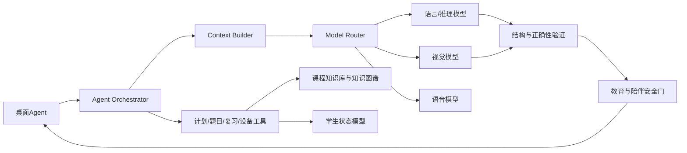

# AI、知识库与学习诊断PRD

日期：2026-08-25  
版本：v0.1  
状态：D4-D12研发基线

## 1. 目标

本PRD定义家庭学习陪伴Agent的模型接入、知识库、课堂内容重建、学习诊断、讲题、计划、PET、竞赛数学、摄像头状态和自迭代机制。系统采用通用模型API加本地知识与规则，不在v0.1训练专用大模型。

## 2. AI系统原则

- 模型输出是候选判断，不是权威事实。
- 课堂内容、错因和行为状态必须带证据、置信度和确认状态。
- 学习辅导优先提示和验证，不直接替孩子完成作业。
- 数学结论、PET评分和高影响家长建议需要独立检查或明确降级。
- 两个孩子的数据只用于各自的个性化状态，不交叉检索。
- 不使用连续家庭原始视频作为云端模型上下文。
- 任何模型不可修改安全规则、隐私规则和家长硬约束。

## 3. 总体架构



## 4. AI Gateway

### HSC-AI-001 统一请求

所有外部模型请求必须通过AI Gateway。请求包含`request_id`、`child_id`、`session_id`、`request_type`、`risk_level`、`context_manifest`、`provider_preference`和`policy_version`。原始API密钥只存在本地安全配置或系统密钥库中。

### HSC-AI-002 输出信封

```json
{
  "request_id": "uuid",
  "output_type": "daily_plan|tutoring|diagnosis|report|dialogue",
  "result": {},
  "reason_summary": "string",
  "confidence": 0.0,
  "evidence_refs": ["string"],
  "model_provider": "string",
  "model_version": "string",
  "prompt_version": "string",
  "knowledge_version": "string|null",
  "policy_version": "string",
  "verification_status": "verified|partially_verified|unverified|rejected",
  "safety_status": "passed|degraded|blocked|escalated",
  "fallback_used": false
}
```

客户端不得把`rejected`结果展示为答案；`unverified`结果只能作为方法建议或参考，并显示不确定性。

本地`model_call`审计记录保存`request_id`、用途、风险级别、服务商首选与实际模型、提示/策略/知识版本、上下文清单、延迟、token、核验/安全状态、降级标记和错误码。审计表不保存孩子问题或模型答案正文。

家长解锁后可按孩子查看脱敏调用历史，包括用途、实际服务商/模型、状态、延迟、输入/输出token、核验/安全、备用模型和脱敏错误；界面不得返回或展示孩子问题、模型回答、请求ID、调用ID或上下文JSON。两个孩子的历史必须按`child_id`严格隔离，切换时清空上一孩子状态。

家长可按服务商和模型配置人民币每百万输入/输出token单价。每次调用完成时把当时单价和估算成本写入不可变快照，后续改价不重算历史；未配置价格必须显示“未估算”，不得按零成本解释。该数值只用于本地预算观察，不等同于服务商账单，真实API验收必须另做账单对账。

### HSC-AI-003 路由与降级

家庭版实现基线：首选与备用端点必须来自不同服务商，密钥分别进入操作系统安全存储。429、5xx和短暂网络错误可在首选端点重试一次；已耗尽完整等待窗口的超时不在同一端点重放，而是直接切换备用或返回可恢复错误。空响应和无效结构可切换备用；400/401/403等请求或配置错误直接显示给家长检查，不用备用成功掩盖。审计保存首选偏好、实际服务商和`fallback_used`，不保存问题与回答正文。

同一服务商内部按任务分流。家长分别配置“学习辅导模型”和“实时意图模型”，二者可共用端点与密钥；`voice_agent_intent*`只进入低延迟模型，讲题、诊断和计划进入辅导模型。Qwen 3.x兼容端点显式使用非思考模式：实时意图最多80个输出token、讲题最多320个输出token、报告最多900个输出token。单端点请求超时后不得在同一端点立即重放造成双倍等待，应直接进入已配置的跨服务商降级或可恢复错误。

2026-08-26在用户提供的OpenAI兼容千问端点上，以不含真实孩子数据的固定集合完成首轮候选验证：`qwen3.8-flash`实时意图26/26完成、准确率100%、P50 787ms、P95 2619ms、高置信错误0、对抗越权0；`qwen3.7-plus`分层讲题20/20完成、概念覆盖90.83%、P50 2623ms、P95 4000ms、提前泄题0、安全违规0。报告保存在本地`artifacts`且不含凭据或真实孩子表达。该结果只证明固定合成集上的候选资格，不替代真实作业、儿童口语、长期教育效果、费用账单或第二服务商验证。

| 请求 | 首选能力 | 验证 | 降级 |
|---|---|---|---|
| 课堂口述抽取 | 语言模型结构化抽取 | 字段Schema、教材候选 | 关键词和人工确认 |
| 作业图片理解 | 本地OCR或视觉模型 | 图像质量、孩子确认 | 手工选择学科和页码 |
| 每日计划 | 推理模型＋约束求解 | 硬约束程序检查 | 规则模板计划 |
| 讲题 | 推理模型＋知识检索 | 第二模型、规则或计算工具 | 只给方向提示、待复核 |
| PET评分 | 任务模型＋量表 | 样本校准 | 标记参考分 |
| 摄像头状态 | 本地视觉规则/模型 | shadow反馈 | unknown、不干预 |
| 家长报告 | 语言模型＋证据模板 | 事实引用、禁用表达 | 结构化事实报告 |

### HSC-AI-004 本地儿童安全路由

孩子语音或文本先经过不可由云模型修改的本地安全路由，再进入普通意图和讲题模型。`R0`普通学习压力只在孩子端承接，不生成安全提醒；`R1`明显低落或不愿上学生成低压力家长关注；`R2`被欺负、威胁或对回家/上学的明显恐惧要求家长当天线下确认；`R3`自伤、他伤或正在发生危险要求现实中的大人立即接手。

`R1-R3`不得调用首选或备用云模型。家长提醒只保存风险级别、类别、时间、状态和确定性行动脚本，不在家长首页展示孩子原话。孩子端必须如实说明“提醒已保存在本机家长中心”，不得宣称已经自动通知家长、学校、专业机构或紧急服务。家长确认动作幂等、写入审计并跨重启保持；确认不代表危险已经解除。

分类器必须保存独立版本，并通过不需要云模型的固定离线门禁。评测至少覆盖普通表达、学习压力、低落、欺凌/胁迫、当前危险、明确否定、课文/影视/游戏转述、间接表达和多风险优先级；R3固定集召回率必须为100%，R2不低于95%，R1不低于90%，NONE/R0不得误报为R3。固定集由实现团队编写时只能作为回归基线，不能替代独立盲测或专业审核。

## 5. 上下文构建

### HSC-AI-010 最小上下文

每次请求只组装完成当前任务所需的最小上下文。课堂复盘不需要历史敏感倾诉，讲数学题不需要摄像头原始帧，家长报告不需要完整语音原文。

家庭版讲题实现固定采用`cloud_text_privacy_v1`：问题、任务标题和课堂摘要在本地脱敏；课堂摘要仅限同学科最多2条、每条240字。直接敏感倾诉禁止进入通用讲题模型，改走本地安全支持。首选、备用和独立数学核验共享该边界，任何二次调用不得恢复或重新拼接原始文本。

### HSC-AI-011 上下文清单

`context_manifest`记录本轮使用的对象类型、对象ID、时间范围、是否脱敏和来源版本。家长可从结论查看证据，但孩子界面不展示内部上下文清单。

## 6. 四库一图

### 6.1 课程标准库

保存国家课程标准、南京考试政策和学业要求的结构化摘要。核心字段包括地区、学段、年级、学科、能力要求、内容要求、生效时间、来源URL、来源版本和许可说明。

### 6.2 教材与资源索引库

保存孩子实际教材的出版社、版本、ISBN、年级、册次、单元、课次和页码锚点。默认保存索引和必要摘要，不批量复制受版权保护的教材正文。国家和江苏智慧教育平台保存人工可访问链接，不进行未授权爬取。

### 6.3 个人学习证据库

保存孩子的任务、题目、答案、草稿、提示、用时、订正、口述和复测结果。该库是学生状态更新的首要证据，优先级高于模型对一般学生的推测。

### 6.4 教学与行为策略库

每条策略包含适用年龄、学科或场景、触发条件、禁忌、提示阶梯、退出条件、证据来源、策略版本和效果指标。家长沟通策略必须包含完整话术、具体行动、时长和避免事项。

### 6.5 知识图谱

节点包括课程标准能力、知识点、教材章节、题型、常见错因、学习策略、评估任务和复测任务。关系至少包括`prerequisite_of`、`part_of`、`taught_in`、`assessed_by`、`misconception_of`、`remediated_by`和`transfers_to`。

## 7. 知识入库流程

```text
来源登记
-> 许可与使用边界判断
-> OCR或结构化提取
-> 学科与版本识别
-> 知识点映射
-> 去重和冲突检查
-> 质量抽检
-> 发布知识版本
```

每个知识对象必须保留`source_type`、`source_ref`、`license_status`、`content_hash`、`effective_from`、`effective_to`和`review_status`。来源或版本不清楚的内容只能进入隔离区，不能用于高置信讲题。

## 8. 课堂内容重建

### HSC-AI-020 候选生成

系统根据孩子口述、当天作业、教材历史进度、最近课堂记录和课程标准生成候选知识点。输出必须将原始证据和推断部分分开，不能用课标补写孩子未提及的老师要求。

### HSC-AI-021 确认策略

置信度高且有两个独立证据时可建议孩子一键确认；只有教材进度或只有模型推断时保持`inferred`；存在版本冲突、教材不明或语音歧义时保持`unknown`。未确认候选不参与高权重掌握度更新。

## 9. 学生状态模型

### HSC-AI-030 状态对象

每个`child_id + knowledge_node_id`维护掌握概率、证据数量、最近练习时间、最近独立正确时间、提示依赖度、遗忘参数、状态置信度和下一次复测时间。初版采用可解释的贝叶斯或规则更新，不采用深度知识追踪模型。

### HSC-AI-031 证据权重

独立完成的迁移题权重最高；提示后完成、相似原题和口头自评依次降低；课堂推断、单次行为事件和模型猜测不得直接显著改变掌握概率。错题后通过变式和延迟复测，才能把错因从候选提升为稳定模式。

## 10. AI Tutor

### HSC-AI-040 讲题流水线

1. 获取完整题目、孩子答案和可选草稿。
2. 判断题目是否完整、是否存在图表、学科和年级。
3. 检索课程知识点、教材锚点、相似例题和已验证策略。
4. 生成解题计划和第一层提示。
5. 独立验证结论、条件和单位。
6. 通过教育安全门检查是否泄露答案、超纲或使用不当话术。
7. 输出一个提示并等待孩子响应。
8. 完成后生成迁移题和复测任务。

### HSC-AI-041 正确性验证

客观数学题优先使用程序计算、符号工具、代入和边界检查；语文、英语和开放题使用评分量表、来源检索和第二模型复核。模型间冲突时不得自行选择看似合理的答案，必须降级或进入家长待复核队列。

家庭版当前安全基线：数学第6级完整讲解若由首选服务商生成，必须把题目和候选讲解交给另一个已配置服务商单独核验，并把核验调用单独写入模型审计。核验器只允许返回一致或冲突。没有独立端点、核验调用失败、响应不合规或结论冲突时，孩子端只展示继续检查的方法，不展示或保存候选最终答案。跨模型一致仅表示自动交叉核对通过，界面仍提醒孩子用课本方法或代入复核，不宣称程序证明。

### HSC-AI-042 提示策略

提示层级为澄清题意、识别已知与目标、建议表示方法、给局部关系、示范相似题和完整讲解。每次只输出一层，并允许孩子请求更少或更多帮助。

## 11. 每日计划引擎

模型负责理解任务和生成候选安排，程序负责硬约束。计划评分考虑截止时间、预计时长、认知负荷、到期复测、长期目标、孩子偏好和历史执行偏差。任何模型计划在展示前必须通过最晚结束时间、总时长、休息和重复任务检查。

## 12. PET能力线

### HSC-GOL-010 能力图谱

PET图谱按阅读、写作、听力和口语四项组织，并映射词汇、语法、交际功能、文本类型和任务类型。系统保存每项证据和趋势，不以总词汇量替代四项能力。

### HSC-GOL-011 基线诊断

v0.1提供适龄阅读与听力客观题、短写作、朗读和看图口述。阅读和听力自动计分；写作和口语使用量表给出参考分，并保存评分依据。未经过人工样本校准前，界面必须显示“参考评估”。

### HSC-GOL-012 计划

四年级日常计划优先通过英文对话、故事共创、复述、分级阅读和短写作建立真实能力。考试专项训练随基线逐步增加，不要求先参加KET考试。

## 13. 竞赛数学能力线

### HSC-GOL-020 能力图谱

图谱覆盖数感、运算结构、数论启蒙、平面几何、计数、组合、逻辑推理、应用建模、归纳和表达。每道题必须标记能力领域、前置能力、表示方法、解题策略、难度、来源和验证状态。

### HSC-GOL-021 训练策略

系统评价独立建模、提示依赖、解法数量、表达完整性、迁移和坚持过程。赛事获奖作为外部结果，不反向驱动系统大量训练未经验证的套路题。

## 14. 摄像头状态引擎

### HSC-OBS-020 输入与输出

首版在本地低帧率处理人物存在、桌面区域、书写样动作、停顿和离座。输出`present`、`away`、`writing_like`、`paused_like`和`unknown`，并包含置信度、持续时间、模型版本和shadow标记。

### HSC-OBS-021 行动边界

视觉事件只能作为任务状态的辅助证据。`paused_like`不能直接解释为走神；中置信度事件只允许询问；低置信度和`unknown`不触发介入。默认不保存连续帧，只保留结构化事件和必要的本地质量抽检样本。

## 15. 家长教练

报告生成必须先汇总事实，再形成谨慎解释。每个建议包括：适用场景、孩子特点、家长可直接说的一套话术、今天做什么、做多久、停止条件、不要做的示例和替代表达。系统不得根据一天数据评价孩子或家长人格。

## 16. 受控自迭代

### HSC-AI-050 自动更新范围

允许自动更新知识掌握概率、遗忘时间、预计任务时长、提示接受度、提醒偏好和下一次复测时间。每次更新保存旧值、新值、证据和算法版本。

### HSC-AI-051 策略进化

首版只允许进化`tutor_hint_pacing`：在第1至3级提示中限制为不超过3个短句，先请孩子复述一个已知条件，再给下一小步。提示等级与答案边界、教育安全规则、隐私上传规则、家庭时长与家长约束为冻结边界，不得由候选策略改写。

状态机为`draft -> replay_passed -> shadow -> active`，家长可在`replay_passed`、`shadow`或`active`手动回退为`rolled_back`。历史回放至少需要近30天3次真实讲题反馈且配置通过低风险allowlist；证据不足时保持`draft`。影子期至少记录3个适用讲题回合，只记录不改变孩子收到的提示；启用操作只对家长PIN解锁会话开放。

每个适用讲题回合保存策略实验和版本，每次状态转换保存操作人、原因、当时指标和时间。活跃策略一旦触发安全/答案泄露替换立即自动回滚；或在至少3次活跃反馈后，自诉理解率比历史基线低超过25个百分点时自动回滚。任务完成、延迟复测、主动介入和误提醒作为后续比较证据，首版不用小样本直接触发策略启用。

家长端必须显示人可理解的状态、证据门槛、冻结边界和回滚原因，不默认展示内部ID或原始JSON。策略实验、评估和转换记录纳入按孩子导出、删除预览和讲题数据分类删除。

## 17. 质量指标

| 指标 | v0.1门槛 |
|---|---|
| 结构化输出合法率 | 100%，不合法结果重试或降级 |
| 模型请求可追溯率 | 100%包含模型、提示、策略和知识版本 |
| 低置信度降级 | 课堂、作业、题目和行为场景100%覆盖 |
| 数学高置信错误 | P0，发现即阻塞相关自动讲题 |
| 原始连续视频上传 | 0 |
| PET未校准评分标识 | 100%显示参考状态 |
| 主动介入证据 | 100%包含触发、置信度和孩子响应 |

## 18. 评测集

两周版本至少建立：20条儿童课堂口述、30张真实或脱敏作业图片、每个主要学科20道代表性题、20个计划冲突场景、20个主动提醒场景、PET四项小样本和20道分层竞赛数学题。评测结果按模型版本、知识版本和策略版本保存，不能只记录总体通过率。

首批可执行讲题集为20条不含真实孩子信息的合成案例，初三和四年级各10条，覆盖校内主要学科、PET、竞赛思维、情绪承接、依恋边界、索要答案和题干缺失。评测必须走与孩子端相同的`/tutor`接口和模型审计链，使用独立临时数据库，报告不得包含密钥或家庭数据。

每次候选模型或提示版本变更至少记录成功率、P50/P95延迟、输入/输出token、按当前价格估算的人民币成本、备用模型调用次数、过早答案泄漏、安全禁语和概念覆盖。v0.1自动门槛为成功率不低于90%、P95不高于15秒、答案泄漏与安全禁语均为0、平均概念覆盖不低于70%；该门槛用于拦截明显不合格版本，不等同于教育效果证明。
