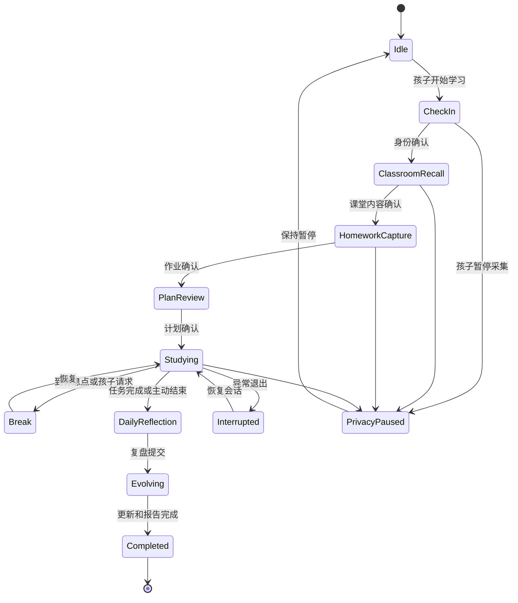

# 每日学习闭环详细PRD

日期：2026-08-25  
版本：v0.1  
状态：D4-D12研发基线

## 1. 目标

本PRD定义孩子从回家打开电脑到学习结束的完整交互、业务状态、数据写入和失败恢复要求。该流程是家庭学习陪伴Agent的权威主流程，其他讲题、摄像头、PET、竞赛数学和家长报告能力必须通过该流程产生或消费数据，不得建立互不相通的旁路。

## 2. 状态机



## 3. 自动启动与身份

### HSC-ID-001 自动启动

应用随目标家庭电脑的孩子账号登录自动启动。启动后显示上次是否正常结束、设备状态、网络状态和继续未完成会话入口。自动启动失败时，安装程序必须提供可见修复入口。

### HSC-ID-002 身份选择

首版优先使用独立系统账号映射孩子档案；无法采用独立账号时，在进入报到前由孩子说出自己的固定称呼或个人唤醒词。孩子端不得以点击头像作为必需路径。系统不得仅依赖云端人脸识别确定身份。

验收：身份确认之前不允许写入学习证据；切换孩子时必须结束或保存当前会话；家长视图可以检查当前`child_id`和数据目录，但孩子界面不显示内部ID。

## 4. 报到与传感器

### HSC-DLY-001 开始学习

孩子说“开始今天的学习”后，系统创建`daily_session`并进入`check_in`。屏幕同时显示麦克风、摄像头和高拍仪状态。麦克风用于当前对话，摄像头在家庭规则允许时进入观察模式，高拍仪保持待命。孩子不需要点击开始键。

### HSC-DAT-002 隐私控制

孩子可随时说“别听了”“关闭摄像头”或“暂停观察”。停止命令必须在本地执行，不等待模型API。隐私暂停后，麦克风不再监听，因此恢复采集必须使用家长控制或物理隐私控制；系统不能伪称语音仍可恢复。

## 5. 课堂复盘

### HSC-DLY-010 自由口述

Agent先使用开放式问题邀请孩子自由回忆，不逐科审问。首轮建议话术为：“今天学校有什么让你印象比较深的？哪门课讲了新东西？”系统保存结构化摘要，不默认长期保存普通口述原始音频。

### HSC-DLY-011 内容抽取

每条课堂内容至少包含：学科、孩子原意摘要、可能知识点、教材映射、证据来源、置信度和确认状态。确认状态仅允许：

- `confirmed`：孩子明确确认或有教材、作业证据支持。
- `inferred`：结合进度和课标得到的高概率推断。
- `unknown`：证据不足或存在冲突。

### HSC-DLY-012 澄清规则

系统每次最多提出4个关键澄清问题。中置信度给出两个选择，低置信度请求孩子补充或保持未知。课标只能用于缩小候选范围，不能证明学校当天实际讲授内容。

## 6. 作业采集

### HSC-CAP-001 采集流程

孩子将作业本、练习册或老师任务页放在高拍仪下。界面提供实时预览、自动裁切、拍摄、重拍和旋转。图片质量检查至少覆盖模糊、过曝、阴影、裁切缺失和手部遮挡。

### HSC-DLY-020 作业结构

每个作业项包含：学科、任务类型、题目或页码范围、截止时间、老师特殊要求、预计时长、来源图片、OCR置信度和孩子确认状态。任务类型包括书面作业、背诵、朗读、订正、复习、预习和备考。

### HSC-DLY-021 人工确认

系统先展示可读的任务清单，再由孩子语音确认。OCR低置信字段必须突出显示。孩子修改后的结果立即持久化，不因后续模型失败而丢失。

实现要求：作业新增和修改使用独立`client_action_id`幂等；修改保存前后值。OCR确认时将`capture_artifact.artifact_id`和引擎原始置信度写入作业项；删除采集记录时解除该引用，不删除已经由孩子确认的作业文本。

孩子确实想不起课堂内容或当天没有校内作业时，必须提供明确的语音和触控声明入口。声明作为独立事件持久化、导出和删除，不自动补写课堂内容，不生成虚构作业，也不推断态度、记忆或能力。四年级随后出现PET、数学思维或到期复测任务时，日报仍须区分“没有校内作业”和“存在长期目标任务”。

## 7. 计划生成

### HSC-DLY-030 输入约束

计划器输入包括：当前时间、最晚结束时间、固定家庭活动、已确认作业、明日检查或考试、历史实际用时、当前精力、到期复测和长期目标。`inferred`作业不得作为硬性必须完成任务，除非孩子确认。

实现基线：`constraint_rules_v4`对已确认作业先按非空截止时间升序排列；任务类型决定高/中/低认知负荷和完成核对标准；老师特别要求追加到该任务的完成标准。这些决策只消费已持久化且由孩子确认的作业项。

### HSC-DLY-031 优先级

优先级依次为：明日必须提交或考试任务、校内基础薄弱点、到期复测、初三中考任务、四年级PET最小任务、竞赛数学任务。作业负荷过高时，PET保留10分钟左右的听说或阅读活动，竞赛数学可延期，但不得无限累积。

### HSC-DLY-032 计划约束

- 不突破家长设定的最晚结束时间。
- 单次连续学习时长不超过家庭规则。
- 每个高负荷任务后安排休息或低负荷任务。
- 保留不少于计划总时长10%的机动时间。
- 未完成任务重新规划时必须记录原因，不自动全部堆到第二天。
- 校内作业延期后，在同一孩子下一次会话的作业阶段逐项显示原任务、原日期和延期原因。孩子必须明确选择“今天继续”“已在其他时间完成”或“老师已取消或不再要求”；只有“今天继续”会生成今天的新作业，且保留来源账本。未处理的延期项会阻止声明无作业和生成计划，两个孩子的候选与决定严格隔离。

### HSC-DLY-033 孩子确认

系统给出不超过两个任务顺序方案，由孩子选择或调整。确认后生成带开始时间、预计时长、完成标准和下一步的时间表。计划变更必须保存原计划、变更内容和原因。

## 8. 学习陪伴

### HSC-DLY-040 任务执行

每个任务支持`planned`、`active`、`paused`、`completed`、`skipped`、`rescheduled`和`failed`状态。界面固定显示当前任务、剩余时间、下一任务、求助、暂停和结束按钮，动态内容不得造成布局跳动。

标记完成前记录确认方式和可选备注。触控支持“已完成并检查”、“已完成”和“还需订正”；语音完成单独标记为语音确认。日报必须将待订正项作为事实呈现，不得推断为已掌握。

选择“已完成并检查”时，根据任务类型显示两项具体核对：书面作业检查漏题，背诵进行脱稿自测，阅读说出主要内容，订正说清原错因，复习做题或口述自测，预习记下问题，备考标出不确定处，思维题说出主要思路。完成核对是孩子自报证据，不能单独提升知识掌握概率。

### HSC-AGT-001 语音意图

首版必须支持：开始学习、课堂复盘、登记作业、确认计划、开始任务、暂停、继续、提问、拍题、给提示、简单一点、重复、我做完了、安静一段时间、关闭观察、结束今天学习和找家长。

### HSC-AGT-002 打断

孩子说“停”或开始新问题时，TTS目标在500ms内停止，并保留上一轮可恢复上下文。停止和隐私指令的优先级高于所有模型输出。

Agent每轮先持久化意图和待执行动作，界面完成计划切换、讲题、设备或任务工具后，再回写孩子实际看到/听到的最终回复、工具状态、错误码和完成时间。“重复”和“简单一点”必须读取最终回复，不能读取执行前占位话术；结果回写失败不得伪装成工具已保存。

## 9. 主动介入

### HSC-OBS-010 触发来源

允许的触发来源包括计划到时、休息到时、孩子主动求助、同一错误重复、任务长时间无进展以及高置信离座事件。摄像头单一视线、坐姿、表情或动作不能直接触发评价性话术。

### HSC-OBS-011 介入阶梯

```text
保持安静
-> 询问是否需要帮助
-> 帮助澄清任务
-> 给方向提示
-> 给局部步骤
-> 示范相似问题
-> 最后才解释原题
```

### HSC-OBS-012 反打扰

- 默认同一任务10分钟内最多2次主动提醒。
- 孩子说“等一下”后创建`snooze`，到期前不追问。
- 孩子说“判断错了”后撤回当前推断并记录纠错。
- 误提醒达到家庭阈值后自动退回影子模式。
- 不使用“你又”“别人都”“再不就”“妈妈会生气”等表达。

家庭版将`snooze_until`存入当日会话，因此应用重启不提前解除静默。误提醒阈值由家长配置为1至10次，按最近7天统计；达到阈值时更新观察策略为影子模式并记录系统审计。孩子主动提问不受静默限制，静默只抑制系统主动追问。

## 10. 提问与讲题

### HSC-CAP-010 题目获取

孩子说“我不会这道题”时，系统先检查是否已有当前题目上下文；没有时提示孩子将题目放到高拍仪下。图像不清晰、题干缺失或多题无法定位时要求重拍或圈选，不得猜测题目。

### HSC-LRN-010 提示与验证

Agent首轮给方法方向或澄清问题，不直接给完整答案。数学最终结论必须经过独立验证链；无法验证时只提供思路并进入待复核队列。每次提示记录层级、内容摘要、孩子响应和用时。

### HSC-LRN-011 错因假设

错因候选包括知识缺失、题意理解、计算或操作、方法选择、表达书写、状态影响和偶然失误。系统至少使用孩子口述、草稿、同类题或变式题中的一种补充证据，才能提高错因置信度。

## 11. 完成验证与复测

### HSC-DLY-050 完成证据

- 书面作业：完成页图片、漏题检查和孩子确认。
- 背诵：少量抽检与孩子自评。
- 英语朗读：保存评分摘要，原音频按专项授权处理。
- 错题订正：孩子说明原错误原因并完成变式。
- 竞赛数学：口述或书写完整思路，不只记录答案。

### HSC-LRN-020 复测调度

系统根据证据质量安排即时变式、48小时复测和7天复测。复测题不能与原题只做数字替换而保持明显记忆线索。复测结果更新掌握概率、遗忘时间和提示依赖度。

## 12. 当日复盘与结束

### HSC-DLY-060 复盘

Agent最多询问三个问题：今天学会了什么、哪里还不确定和明天第一件要做什么。孩子可部分回答或跳过，系统不能因未回答而阻止结束；跳过状态独立留痕，不从空白内容生成学习证据或心理推断。

### HSC-DLY-061 受控迭代

系统更新知识掌握、预计用时、提示接受度、提醒偏好和复习队列。安全规则、隐私规则、家长约束和核心提示策略不得自动修改。

### HSC-DLY-062 关闭会话

结束顺序必须为：提交数据库事务、生成待处理报告任务、清理临时媒体、停止摄像头与麦克风、验证设备句柄释放、显示完成页。报告生成失败不应阻塞传感器关闭。

完成页必须显示本次会话的应用设备租约摘要。仍有活动租约时不得显示完成式隐私文案；应用租约全部结束后仍要注明Windows系统级释放是否经过真实设备验证，不能用数据库状态代替操作系统证据。

### HSC-DLY-063 未提交输入保护

报到、课堂口述、作业编辑、学习讲题/完成核对、复盘和Agent输入在修改后自动保存本地会话草稿，并显示保存中、已保存或失败状态。刷新、应用重启或本地服务重启后恢复到原字段；业务提交成功时清除对应草稿，禁止慢到达的旧防抖请求在清除后重新写回。

## 13. 家长日报

日报包含：今天确认完成的事实、需要谨慎解释的变化、知识与习惯证据、明日复测、家长可直接使用的一套话术、今天做什么和做多久、不要比较/羞辱/追问/威胁的具体替代表达。每条判断可下钻到对应任务和证据，推断必须显示置信度。

日报成功写入后，系统必须同步刷新该孩子当前自然周（周一至周日）和当前自然月（当月首日至末日）的阶段报告。阶段报告是日报的可重建聚合视图，不得把滚动7天或30天冒充自然周期；同一天完成多次会话时，学习天数按日期去重，同时单列会话次数和当日会话数。刷新采用同周期原位更新，保留报告ID并更新时间，不为每次刷新制造历史副本。

阶段报告刷新失败不得回滚已成功生成的日报，也不得阻塞传感器关闭和完成页。系统须保存周报、月报各自的处理状态、尝试次数和脱敏错误类型；应用启动时对存在日报证据的当前周期自动补偿，恢复后清除待处理状态。家长可手动刷新本周或本月，但手动操作与自动刷新使用同一幂等生成路径。阶段报告和刷新状态必须纳入按孩子导出、报告范围删除和全历史删除。

## 14. 失败与恢复

| 失败 | 产品行为 |
|---|---|
| ASR识别错误 | 展示转写并允许语音或触控修正 |
| 高拍仪离线 | 显示连接指导，允许普通摄像头或文件导入 |
| OCR失败 | 保存原图，允许手工录入范围或调用视觉模型 |
| 模型API超时 | 保留当前任务，重试或切换备用模型 |
| 摄像头离线 | 切换为无视觉陪学，不输出观察结论 |
| 应用崩溃 | 重启后恢复最近一致状态和未完成任务 |
| 网络断开 | 使用已保存计划、计时和本地数据，模型功能明确不可用 |
| 报告失败 | 进入待重试队列，不影响结束和传感器关闭 |

## 15. 界面与交互面

### 15.1 孩子端

| 页面 | 主要内容 | 固定控制 |
|---|---|---|
| 等待首页 | 拟人智能体、日期、继续会话、设备状态 | 开始学习、隐私状态 |
| 课堂复盘 | 实时转写、学科与知识候选、确认状态 | 重说、修改、跳过、下一步 |
| 作业采集 | 高拍仪预览、质量提示、任务清单 | 拍摄、重拍、确认、手工修改 |
| 计划确认 | 时间轴、任务顺序、休息和长期任务 | 选择方案、拖动调整、确认 |
| 学习工作台 | 当前任务、计时、Agent字幕和下一任务 | 求助、拍题、暂停、完成、安静 |
| 题目辅导 | 题目图、当前提示、孩子作答和进度 | 再提示、简单点、我会了、返回任务 |
| 智能错题本 | 待确认、今日强化、待复测、已掌握和薄弱点 | 确认、纠正、开始强化、合理延期 |
| 当日复盘 | 三个可跳过问题、完成摘要 | 回答、跳过、结束 |
| 完成页 | 已完成、待复测、传感器关闭状态 | 返回首页 |

孩子端以语音为主要输入，但所有关键命令必须有触控替代。摄像头、麦克风、保存和模型等待状态持续可见；加载、失败、重试、取消和恢复不能只用语音说明。学习工作台采用稳定尺寸，动态字幕和按钮不得推动计时器、任务标题和关键控制发生位置跳动。

### 15.2 家长端本地视图

| 页面 | 主要任务 |
|---|---|
| 今日概览 | 查看两个孩子的计划、完成、异常和待确认事项 |
| 学习证据 | 从知识结论下钻到题目、作答、提示和复测 |
| 错题与薄弱点 | 查看错题簇、诊断、强化进度、掌握门槛和复发 |
| 报告与建议 | 查看事实、解释、完整话术、具体行动和避免事项 |
| 规则设置 | 配置最晚结束时间、时长、传感器、API和专项优先级 |
| 设备与故障 | 查看在线、占用、权限、错误、重连和最近模型失败 |
| 数据管理 | 备份、恢复、导出、删除和留存状态 |

家长端默认隐藏原始JSON、内部ID和完整模型日志。待确认、待复测和失败重试任务应直接提供处理按钮，不要求家长在多个页面之间寻找证据和操作入口。

## 16. 本地API

| 方法与路径 | 用途 | 关键输出 |
|---|---|---|
| `GET /v1/bootstrap` | 获取当前孩子、未完成会话、设备和隐私状态 | bootstrap_state |
| `POST /v1/sessions` | 创建每日会话 | session_id、state |
| `POST /v1/sessions/{id}/recalls` | 保存课堂口述与确认 | recall_items |
| `PUT /v1/sessions/{id}/planning-context` | 保存精力、固定安排和明日重点 | planning_context |
| `POST /v1/captures` | 高拍仪或摄像头拍摄 | asset_id、quality_result |
| `POST /v1/homework/extract` | 从证据提取作业候选 | homework_candidates |
| `POST /v1/homework/{id}/confirm` | 确认或修改作业 | homework_item |
| `POST /v1/sessions/{id}/deferred-tasks/{plan_item_id}/review` | 逐项处理上次延期校内作业 | decision、reason、target_homework_id |
| `POST /v1/plans/generate` | 生成候选计划 | plan_variants、constraint_result |
| `POST /v1/plans/{id}/confirm` | 确认计划版本 | active_plan |
| `POST /v1/plan-items/{id}/transition` | 变更任务状态 | plan_item、session_state |
| `POST /v1/tutor/turns` | 提问、提示或讲解 | tutoring_output、verification_status |
| `POST /v1/privacy/state` | 暂停或恢复传感器 | sensor_states、release_result |
| `POST /v1/sessions/{id}/complete` | 复盘并结束会话 | completion_summary、job_ids |
| `GET /v1/parent/today` | 获取家长今日视图 | plans、evidence、reports、failures |

所有变更接口要求`client_action_id`实现幂等。错误响应包含用户可理解的`message`、稳定的`error_code`、`retryable`和可选`recovery_action`。API失败不得使已经确认的孩子输入回滚。

## 17. 核心事件

| 事件 | 关键字段 |
|---|---|
| `daily_session_started` | child_id、session_id、device_state |
| `classroom_recall_captured` | subject_count、confirmed_count、inferred_count、unknown_count |
| `homework_item_confirmed` | subject、task_type、source、ocr_confidence |
| `daily_plan_confirmed` | task_count、total_minutes、variant_selected |
| `plan_item_started` | plan_item_id、subject、expected_minutes |
| `learning_help_requested` | task_id、problem_ref、request_type |
| `hint_delivered` | hint_level、verification_status |
| `observation_event_created` | state_type、confidence、shadow_mode |
| `intervention_delivered` | trigger、stage、policy_version |
| `intervention_corrected` | reason、previous_inference |
| `learning_evidence_created` | knowledge_point、correctness、independence、hint_count |
| `review_scheduled` | evidence_id、review_type、due_at |
| `daily_session_completed` | completed_tasks、remaining_tasks、sensor_release_status |

## 18. 验收用例

1. 孩子完成一次自由口述，系统将内容分为已确认、推断和未知，并只追问关键缺口。
2. 高拍仪拍摄含铅笔字和红笔批改的作业页，系统识别任务并允许修正后持久化。
3. 计划因作业增加而调整，但不突破最晚结束时间，旧计划和原因仍可查看。
4. 孩子在学习中关闭摄像头，任务继续运行且系统不再生成视觉事件。
5. 模型讲题超时后进入备用模型或方法提示，孩子输入不丢失。
6. 应用在任务中崩溃并重启，能够恢复当前任务、已用时间和已有证据。
7. 学习结束后报告生成失败，但摄像头和麦克风仍被释放并进入报告重试队列。
8. 两个孩子依次使用系统，任何任务、知识状态、图片和报告均不串档。
