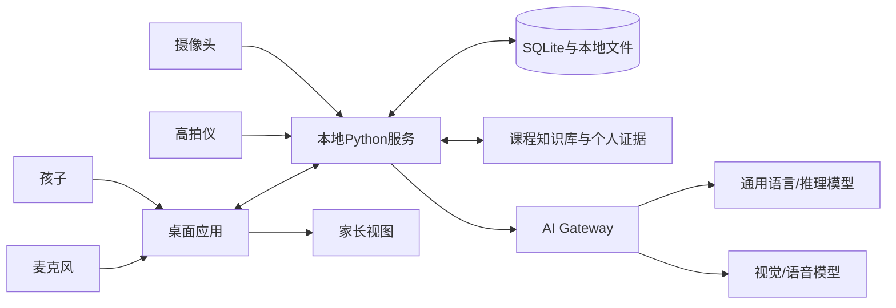

# 家庭学习陪伴Agent总体PRD

日期：2026-08-25  
版本：v0.1  
状态：两周研发基线

## 1. 产品定义

家庭学习陪伴Agent是一套运行在家庭电脑上的本地优先学习软件。系统通过自然语音、高拍仪、摄像头和模型API，帮助一名南京初三学生和一名南京四年级学生完成课堂复盘、作业登记、当日计划、学习辅导、错题复测、习惯引导和家长报告。

产品的核心价值不是替孩子完成作业，也不是持续监控孩子，而是把每天分散的课堂信息、作业证据、学习过程和长期目标组织成可验证的学习闭环，让孩子获得及时、可理解、逐步减少依赖的帮助。

## 2. 用户与目标

| 用户 | 当前情况 | 主要目标 | 产品侧重点 |
|---|---|---|---|
| 初三学生 | 南京初三，时间窗口短 | 发现薄弱点、提高作业与复习质量、服务中考 | 校内任务、错题诊断、复测和考试节奏优先 |
| 四年级学生 | 南京四年级，长期成长窗口较长 | 六年级上学期通过PET，发展竞赛数学与奥赛思维，培养学习习惯 | 英语听说读写、数学思维、习惯和长期陪伴并行 |
| 家长 | 家庭规则制定者和教育协作者 | 掌握事实、减少冲突、获得可执行沟通与行动建议 | 证据、解释、话术、具体行动和避免事项 |

## 3. 产品目标

### 3.1 两周版本目标

- 在一台确定的家庭电脑上完成安装、自动启动和异常恢复。
- 支持两个孩子独立档案、独立知识状态、独立计划和独立报告。
- 跑通课堂口述、作业采集、内容确认、计划生成、学习执行、结束复盘和传感器关闭。
- 支持高拍仪拍题、分层提示、错因假设、即时变式及48小时和7天复测。
- 建立课程知识库最小骨架、PET四项基线入口和竞赛数学能力图谱入口。
- 摄像头输出本地可观察事件并以影子模式为默认；低风险介入必须受置信度和提醒预算约束。
- 所有学习输入和家长操作跨刷新、应用重启和电脑重启持久保存。

### 3.2 长期目标

- 根据复测结果更新知识掌握与遗忘模型。
- 根据真实用时、接受度和任务完成情况优化计划。
- 根据孩子反馈校准主动提醒和讲解方式。
- 逐步提高PET评分、数学诊断和行为事件的可信度。
- 在孩子能力提升后减少提示，提升无Agent独立完成率。
- 形成可从证据事件重建的知识、行为、干预效果和决策状态模型。
- 建立有证据、置信度、有效期和纠正链的长期记忆与LLM Wiki。
- 交付故事、游戏、离屏活动和共同回忆构成的陪伴生活线，同时维持现实关系优先和反依赖边界。
- 为孩子提供适龄成长档案，为家长提供可下钻、可执行、可反馈的长期教练视图。

## 4. 非目标

- 不承诺两周内证明成绩提升、PET通过或竞赛获奖。
- 不做心理、医学、人格或家庭关系诊断。
- 不根据单一表情、视线或动作判断孩子主观状态。
- 不抓取受限教材、商业题库或智慧教育平台内容。
- 不上传连续家庭原始视频。
- 不让Agent在线自行修改安全规则、隐私规则和家长硬约束。
- 不接入学校、老师或随身设备。
- 不开发移动端、专用平板、底座或吊坠。

## 5. 目标运行环境

| 项目 | v0.1要求 |
|---|---|
| 部署形态 | Windows x64桌面App；不以浏览器网页作为孩子端运行入口 |
| 电脑 | Windows 11 x64；最低4核8线程AVX2 CPU、16GB内存、512GB NVMe，无独显要求；完整语料本地保存建议2TB总SSD |
| 摄像头 | USB/UVC优先，或提供本地RTSP/ONVIF流 |
| 高拍仪 | UVC模式、A3或完整练习册幅面、建议800万像素及以上 |
| 麦克风 | USB摄像头内置、电脑内置或独立麦克风 |
| 网络 | 模型API需要外网；断网时保留计划、任务、计时和本地数据 |
| 本地存储 | SQLite数据库和加密学习证据目录 |
| 模型 | 通过统一适配层接入DeepSeek、千问或其他可用模型 |

最低配置、建议配置、无独显算法边界和真实Windows验收负载见[家庭学习陪伴软件最低电脑配置与验收基线](./2026-08-27-minimum-pc-hardware-assessment.md)。最低配置在目标Windows电脑通过双摄像头、OCR、ASR、观察和知识检索并发测试前保持“暂定”，不得因开发机测试通过而标记为已验证。

### 5.1 已采购设备基线

| 设备角色 | 采购记录 | 当前确认状态 | 到货后必须确认 |
|---|---|---|---|
| 作业高拍仪 | 京东SKU `10184877516348`，[商品页](https://item.jd.com/10184877516348.html) | 采购页款式为“汇博士X90L 4K教学展台”；2026-08-27实机枚举为`Fic760xUsbCamera (eba4:1303)`，UVC 4K取流、独立音频输入、应用绑定、真实中文书页OCR和60秒双路并发已通过 | 铭牌是否确为X90L、Windows驱动、铅笔字/批改试卷、忙占/拔插、30分钟双路和60分钟单机 |
| 观察云台摄像头 | 京东SKU `100311808116`，[商品页](https://item.jd.com/100311808116.html) | 2026-08-26移动商品页显示“汇博士YT100 4K AI人形追踪云台摄像头”；不能由宣传中的人形追踪推定第三方软件可控制 | USB或网络接入、UVC/RTSP/ONVIF、PTZ控制、水平/俯仰范围、自动跟踪开放性、本地流、麦克风、隐私关闭 |

采购完成不等于设备适配完成。型号、协议和能力必须通过到货铭牌、操作系统枚举和实机测试写入`device_profile.capabilities_json`；未经验证的能力不得写成已支持。

## 6. 系统架构

v0.1采用“桌面壳 + Web界面 + 本地AI服务”，不是纯Web应用：Electron负责Windows应用生命周期，React负责孩子端和家长端界面，Python本地服务负责设备、OCR、ASR、视觉、知识检索和数据持久化。React代码保留未来复用到家长Web查看端的可能，但孩子每日学习闭环必须从已安装的Windows应用启动。



### 6.1 桌面应用

负责自动启动、孩子身份、语音状态、每日计划、学习会话、设备状态、家长视图和错误恢复。孩子主界面以拟人智能体和语音为主，但所有关键状态必须同时可视化，避免孩子不知道系统是否在听、是否在拍摄或是否已经保存。

### 6.2 本地服务

负责设备适配、OCR、ASR调度、视觉事件、知识检索、计划约束、模型调用、文件加密、事件记录、备份和恢复。桌面应用关闭或崩溃后，本地服务必须能够保存最后一致状态并安全释放传感器。

### 6.3 AI Gateway

负责模型路由、超时、重试、成本记录、敏感信息过滤、结构化输出检查和降级。产品逻辑不能直接依赖某个厂商的具体模型名称。

## 7. 产品模块

| 模块 | 编号前缀 | 责任 |
|---|---|---|
| 自动启动与身份 | HSC-ID | 自动启动、双孩子档案、身份切换和数据隔离 |
| 每日学习闭环 | HSC-DLY | 课堂复盘、作业、计划、执行、复盘和结束 |
| 语音智能体 | HSC-AGT | 意图理解、回应、打断、主动提醒和工具调度 |
| 高拍仪与题目 | HSC-CAP | 教材、作业、题目、草稿、OCR和质量检查 |
| 学习诊断 | HSC-LRN | 知识点、错因、提示、独立程度和复测 |
| 智能错题本 | HSC-ERR | 错题采集、薄弱点聚合、针对性强化、掌握归档和复发 |
| 摄像头状态 | HSC-OBS | 在座、离座、书写、停顿、unknown和影子模式 |
| 专项目标 | HSC-GOL | 初三中考、四年级PET和竞赛数学 |
| 家长支持 | HSC-PAR | 报告、话术、行动、避免事项和规则 |
| 数据与隐私 | HSC-DAT | SQLite、文件、传感器、删除、备份和审计 |
| 质量与运维 | HSC-OPS | 设备健康、模型日志、失败队列和版本回滚 |
| 长期状态模型 | HSC-MDL | 知识四维状态、行为基线、干预效果和决策解释 |
| 长期记忆 | HSC-MEM | 证据型LLM Wiki、共同记忆、成长档案和纠正链 |
| 陪伴生活 | HSC-CMP | 日常仪式、故事、游戏、离屏活动和依恋边界 |

完整产品范围、数据对象、服务边界和逐项完成门槛以[长期能力与全量功能PRD](./2026-08-27-longitudinal-capability-and-full-product-prd.md)为准。两周版本是该完整范围的首个可运行纵向切片，不构成对长期能力和陪伴功能的范围删除。

## 8. 核心用户旅程

### 8.1 每日学习

1. 孩子登录家庭电脑，应用自动启动并识别或确认孩子身份。
2. 孩子说开始今天的学习，系统进入报到状态。
3. 孩子自由口述当天课堂内容和老师提醒。
4. 系统结合教材进度、课标和历史记录形成已确认、高概率推断和未知内容。
5. 孩子使用高拍仪采集作业本、练习册或任务清单并确认结果。
6. 计划器结合截止时间、睡眠、精力、校内任务和长期目标生成当日时间表。
7. 孩子选择任务顺序并确认计划。
8. Agent陪伴学习，按任务状态和孩子请求提供帮助。
9. 任务完成后保存证据并安排必要复测。
10. 当日复盘完成后更新孩子模型，生成家长日报并关闭摄像头和麦克风。

### 8.2 中断与恢复

孩子可以暂停、退出、切换任务或关闭观察。任何中断都必须先保存当前任务、会话状态、已经确认的作业和输入内容。再次启动时显示明确的继续入口，不要求孩子重复口述已经保存的信息。

### 8.3 设备或模型失败

摄像头、高拍仪、麦克风、OCR、ASR或模型API失败时，界面必须显示真实原因、当前影响、重试入口和替代方式。系统不得使用演示数据或旧结果伪装本次处理成功。

## 9. 核心功能需求

| 编号 | 需求 | 级别 | 验收摘要 |
|---|---|---|---|
| HSC-ID-001 | 应用随目标电脑登录自动启动 | MUST | 重启后无需开发命令进入等待状态 |
| HSC-ID-002 | 两个孩子数据严格隔离 | MUST | 任务、证据、知识状态和报告不可串档 |
| HSC-DLY-001 | 完成课堂自由口述与结构化确认 | MUST | 推断内容有来源和置信度 |
| HSC-DLY-002 | 完成作业采集、编辑和确认 | MUST | 不静默生成不存在的作业 |
| HSC-DLY-003 | 生成满足硬约束的当日计划 | MUST | 不突破睡眠和总时长约束 |
| HSC-DLY-004 | 任务支持开始、暂停、完成、延期和恢复 | MUST | 重启后保持最后状态 |
| HSC-AGT-001 | 语音支持唤醒、打断、暂停和重说 | MUST | 停止命令本地立即生效 |
| HSC-SAF-001 | 敏感表达在本地按R0-R3分级并引导现实大人接手 | MUST | R0不告警；R1-R3不调用云模型，家长提醒不展示原话且可确认；固定合成集满足R3零漏判发布门槛，真实表达另行盲测 |
| HSC-CAP-001 | 高拍仪支持预览、拍摄、重拍和裁切 | MUST | 低质量图片不能进入高置信讲题 |
| HSC-LRN-001 | 讲题采用分层提示 | MUST | 首轮不直接给完整答案 |
| HSC-LRN-002 | 错因以假设和证据表达 | MUST | 单次错误不固化为能力标签 |
| HSC-LRN-003 | 支持即时、48小时和7天复测 | MUST | 复测结果更新知识状态 |
| HSC-ERR-001 | 错题进入统一掌握闭环 | MUST | 从采集到掌握归档和复发全程可追溯 |
| HSC-ERR-002 | 从多道错题聚合薄弱点 | MUST | 单题不固化标签，结论可下钻到证据 |
| HSC-ERR-003 | 分层变式直至达到掌握门槛 | MUST | 不机械重复，连续失败退回补救且无无限加题 |
| HSC-OBS-001 | 摄像头默认输出本地事件 | MUST | 原始连续视频不上传 |
| HSC-OBS-002 | 行为判断支持unknown和影子模式 | MUST | 低置信度不触发干预 |
| HSC-GOL-001 | 初三目标进入计划优先级 | MUST | 校内和中考任务优先，不等待视觉模块 |
| HSC-GOL-002 | PET与竞赛数学形成基线和周任务 | MUST | 未校准评分显示为参考 |
| HSC-PAR-001 | 生成可执行家长日报 | MUST | 包含事实、解释、话术、行动和避免事项 |
| HSC-DAT-001 | 数据跨刷新和重启持久化 | MUST | 恢复测试通过 |
| HSC-DAT-002 | 会话结束后关闭传感器 | MUST | 操作系统确认应用不再占用 |
| HSC-OPS-001 | 模型与设备失败可观察、可重试 | MUST | 家长无需查看原始日志 |

## 10. 状态模型

```text
idle
-> check_in
-> classroom_recall
-> homework_capture
-> plan_review
-> studying
<-> break
-> daily_reflection
-> evolving
-> completed
```

所有状态变化必须带`child_id`、`session_id`、时间、来源和结果。`privacy_paused`、`interrupted`和`recovery_required`作为可从任意活动状态进入的控制状态。

## 11. 成功指标

### 11.1 两周发布指标

| 指标 | 目标 |
|---|---|
| 完整日常流程 | 在目标设备连续运行3次，无P0故障 |
| 数据持久化 | 刷新、应用重启和电脑重启后100%恢复关键数据 |
| 双孩子隔离 | P0测试100%通过 |
| 传感器关闭 | 会话结束后100%释放摄像头和麦克风 |
| 不确定内容处理 | 低置信度课堂、作业和题目100%进入确认或降级 |
| 错误恢复 | 设备拔出、API超时、OCR失败均有可见重试或替代路径 |
| 儿童安全路由 | 固定R0-R3用例100%本地分级；R3不得落入普通聊天 |

### 11.2 上线后效果指标

- 每日计划确认时间、任务完成率和实际用时偏差。
- 孩子主动求助率、主动介入接受率和误打扰率。
- 48小时和7天复测保持率。
- 提示依赖度与无Agent独立完成率。
- PET四项能力趋势和竞赛数学迁移能力。
- 家长建议执行率、有效性反馈和压力评分。

## 12. 非功能要求

- 首屏冷启动目标不超过5秒，自动启动后30秒内可开始报到。
- 本地停止、隐私暂停和传感器关闭不依赖云端。
- 模型请求默认超时15秒，超时后显示降级方案。
- 每次模型调用记录用途、提供商、模型版本、延迟、成本和安全结果。
- 数据库写入采用事务，关键状态变更在回应孩子前完成持久化。
- 每日自动备份，保留至少7个可恢复版本。
- 界面必须覆盖加载、空状态、错误、重试、取消和恢复状态。
- 家长视图不以原始JSON、内部ID或模型日志作为主要界面。

## 13. 发布边界

第14天可以声明的完成层级包括：代码可运行、自动化测试通过、数据持久化通过、目标电脑和真实设备流程通过、家庭版v0.1可开始试用。尚不能声明的层级包括：长期教育价值已证实、摄像头能准确理解心理状态、PET评分与官方结果等价、竞赛获奖概率得到验证。

## 14. 外部依赖与阻塞

- 目标家庭电脑的操作系统、型号、内存和可用空间。
- 摄像头和高拍仪在D3前到货并可退换。
- 至少一个首选模型API和一个备用模型API的有效凭据。
- 两个孩子当前教材目录和少量非敏感作业样本。
- 家长确认最晚结束时间、单次时长和传感器关闭规则。
